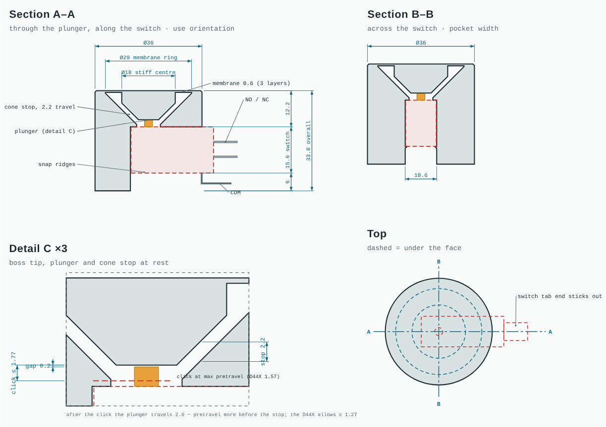

# TPU membrane button — v0.1 mock

A single arcade button printed as **one TPU part**: the button face is a 2–3 layer membrane printed on the bed, a stiff centre presses the microswitch, and a 45° cone stops the travel before the switch can be over-pressed. The microswitch pushes in from underneath, and its tab end sticks out the side like on a Happ button. No supports.

Part of the [arcade-button-box](..) study: aimed at cutting box depth from ~94 mm (long-barrel buttons) to ~34 mm.

Status: **v0.1, sliced and ready to print, not yet printed.** 14 Nov 2026.

## Requests (verbatim)

14 Nov 2026, 16:43:

> Can you do me a mock design of a single TPU membrane button?
>
> Ideally it should be entirely TPU and can hold the  micro switch by slotting it in from the bottom or side
>
> I would like to print it as soon as it it’s ready so this chat needs to go GitHub as a research piece (a folder, not a branch)

14 Nov 2026, 16:44:

> The membrane would be maybe 2-3 layers thick, the less the better I think

14 Nov 2026, 16:57:

> Ohhhh I just realised we’re not on the same page regarding the micro switches

14 Nov 2026, 16:59: screenshot of the switch being used: austinamusements.com.au, *"Bulk Buy- 100 x Microswitch For Arcade Buttons"*, brand B.Lee, $135.00. Red body, orange plunger at one end of the top face, NO/NC tabs out the far end, COM out the bottom near that end, two mounting holes at diagonal corners.

14 Nov 2026, 17:10: three caliper photos of the switch (no text), read off the beam scale because the display was off:

| | Read from photo | Used |
|---|---|---|
| Body length | ≈ 28 | 27.8 |
| Body height | ≈ 15.6 | 15.6 |
| Height including plunger | ≈ 17.8 | → plunger 2.2 proud |
| Plunger centre from its end | ≈ 5.9 | 5.9 |
| Plunger width | ≈ 2.7 | 2.7 |
| Thickness | not measured | 10.3 (Cherry D44X) |

Reading accuracy is about ±0.3 mm.

## How it works

Modelled in print orientation: the bed is the button face.

| Layer up from the bed | What it is |
|---|---|
| 0–0.6 (3 layers) | membrane across the whole face; free to flex in the ring Ø18–Ø29 |
| Ø18 centre | solid boss bonded to the membrane, tapering at 45° to a Ø6.8 tip that presses the plunger |
| 45° cone | the body grows inward from the Ø29 rim at 45°, parallel to the boss cone and 2.2 mm away: that gap is the travel, and cone landing on cone is the hard stop (self-centring, also limits tilt) |
| 12.2 down | ceiling the switch's top face sits against, with a Ø8 throat for the tip |
| pocket | 10.6 wide, open at the bottom and at the tab end; two 0.6 mm snap ridges catch the switch's bottom edges |
| +6 | base below the switch so COM clears the desk |

Travel budget at rest: 0.2 gap to the plunger, click within 0.2 + 1.57 (D44X max pretravel) = 1.77, cone stop at 2.2. After the click the plunger moves at most another 2.0 − pretravel, inside the D44X's ≥ 1.27 overtravel.

## Print

**`gcode/tpu_button_TPUsafe_0.20SPEED_solidboss.gcode`**: 3-layer (0.6) membrane, **1 h 44 min, 17.3 g**.
2-layer (0.4) membrane: `gcode/tpu_button_m04_TPUsafe_0.20SPEED_solidboss.gcode`, 1 h 43 min, 17.1 g.

Both are face down, no supports, eSun TPU 95A @MK3S (the forum-safe preset that the braid tool printed well with), 0.20mm SPEED. To slice it yourself in PrusaSlicer: printer *Original Prusa i3 MK3S & MK3S+*, print *0.20mm SPEED @MK3*, filament *eSun TPU 95A @MK3S* from [printer-profiles](../../printer-profiles/esun-tpu95a-mk3s), then **Perimeters 3**, **Infill > Solid infill threshold area 260 mm²** (makes only the Ø18 centre solid) and **Avoid crossing perimeters**.

- **Sheet:** textured or satin; glue stick on smooth PEI.
- **First layer:** the membrane *is* the first layers, so watch them. Gaps or a starved ring show up as holes in the face.
- **Removal:** flex the steel sheet and lift from the outer edge. Don't peel the middle up first: the 0.4–0.6 ring tears or stretches before the solid parts let go.

## Fit and test

1. Push the switch in from underneath, plunger end first towards the closed end of the pocket, tabs out through the side slot, until it snaps past the ridges and its top sits against the ceiling.
2. Meter across COM–NO (or wire it to the ESP32), then check:

| Check | Pass | If not |
|---|---|---|
| At rest | open | already clicked → the plunger is taller than 2.2: put a layer of tape between the switch top and the ceiling, or reprint with `pl_free` raised |
| Press the centre | clicks before the cone stops | no click → plunger shorter than 2.2: reprint with `pl_free` lowered (or `stop` 2.4) |
| Press near the edge of the Ø29 face | still clicks | soft edge → bigger `r_boss` |
| Release | springs back, clicks off | sticky → 3-layer membrane instead of 2 |
| Feel | your call | stiffer → thicker `membrane` or narrower ring (`r_rim`); lighter → the opposite |
| Switch retention | doesn't drop out when shaken | loose → `ridge` 0.8, or `c_y` 0.05 |

3. Report back what passed, which membrane you preferred, and how the click feels.

## Parameters (`tpu_button.scad`)

| Name | Default | Meaning |
|---|---|---|
| `membrane` | 0.6 | face thickness: 0.4 = 2 layers, 0.6 = 3 (first layer 0.2) |
| `r_rim` / `r_boss` / `R_out` | 14.5 / 9 / 18 | flexible face Ø29, stiff centre Ø18, puck Ø36 |
| `stop` | 2.2 | travel to the cone stop |
| `gap0` | 0.2 | tip-to-plunger gap at rest |
| `r_throat`, `lip` | 4, 0.8 | hole and ceiling at the plunger |
| `sw_L`, `sw_T`, `sw_H` | 27.8, 10.3, 15.6 | switch body |
| `pl_off`, `pl_d`, `pl_free`, `pl_pt` | 5.9, 2.7, 2.2, 1.57 | plunger position, width, height, max pretravel |
| `c_y`, `c_end` | 0.15, 0.2 | pocket clearance |
| `ridge`, `ridge_x` | 0.6, [−2, 12] | snap ridges |
| `base_clear` | 6 | below the switch; 0 when it goes into a box |

Height from face to switch top is `membrane + 0.3 + (r_rim − r_throat) + lip` = 12.2: the 45° cone from the rim to the throat sets it. Overall 33.8 with the 6 mm base, about 32 in a box including the COM tab.

## Print times (PrusaSlicer 2.7.2, stock MK3S+, 0.20mm SPEED)

| STL | Filament | stock (2 perimeters, 15 %) | **solidboss** (3 perimeters, solid centre) |
|---|---|---|---|
| `tpu_button` (0.6 membrane) | eSun TPU 95A (safe) | 1h 25m, 13.9 g | **1h 44m, 17.3 g** |
| | eSun TPU 95A FAST | 1h 07m, 14.3 g | 1h 21m, 17.8 g |
| `tpu_button_m04` (0.4 membrane) | eSun TPU 95A (safe) | 1h 24m, 13.7 g | **1h 43m, 17.1 g** |
| | eSun TPU 95A FAST | 1h 07m, 14.1 g | 1h 20m, 17.5 g |

G-code check (`check_gcode.py`): the 0.6 file prints the free ring on layers 1–3 and nothing in it from layer 4; the 0.4 file on layers 1–2. The centre boss prints as solid infill. Overhang check (`check_overhangs.py`): only the two 0.6 mm snap-ridge ledges (17 mm²) are steeper than 45°.

## Open questions

- Plunger height is the key number (±0.3 from the photo). The test print settles it.
- Membrane fatigue: TPU 95A at ~2 mm deflection over a 5.5 mm ring may take a set over thousands of presses.
- Panel mounting for the box (flange, or a multi-button mat) is not designed yet.
- The thickness (10.3) wasn't measured; the pocket is 10.6.

## Files

| File | Purpose |
|---|---|
| `tpu_button.scad` | the model. `part = button / switch / info` |
| `render_all.sh` | STLs (0.6 and 0.4 membranes), `info.json`, overhang check |
| `slice_all.py` | slices with the repo's eSun TPU presets → `print_times.json`, keeps the safe solidboss G-code |
| `check_gcode.py`, `check_overhangs.py` | membrane layer / boss fill check; overhang check |
| `drawings.py` | `img/tpu_button_drawing.svg/.png` from STL sections |
| `stl/`, `gcode/`, `img/` | outputs |

Regenerate: `./render_all.sh && python3 slice_all.py && python3 drawings.py`.

## Sources

- Cherry D44X operating data (75 cN, pretravel 1.57 max, overtravel 1.27 min): [Arcadexpress](https://arcadexpress.com/en/microswitches/144-cherry-d44x-48mm-button-microswitch.html), [Paradise Arcade](https://paradisearcadeshop.com/products/cherry-pushbutton-microswitch)
- D4-series body 27.8 × 10.3 × 15.9: [Cherry/ZF catalogue](https://www.roger-tech.com/pdf-0d/DB2CA1RC.pdf)
