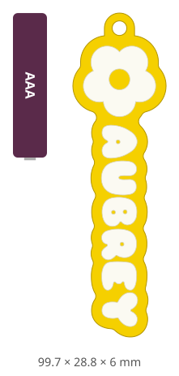
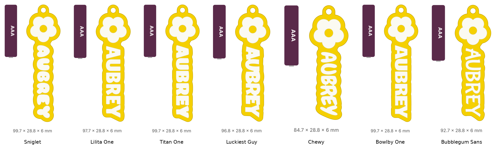
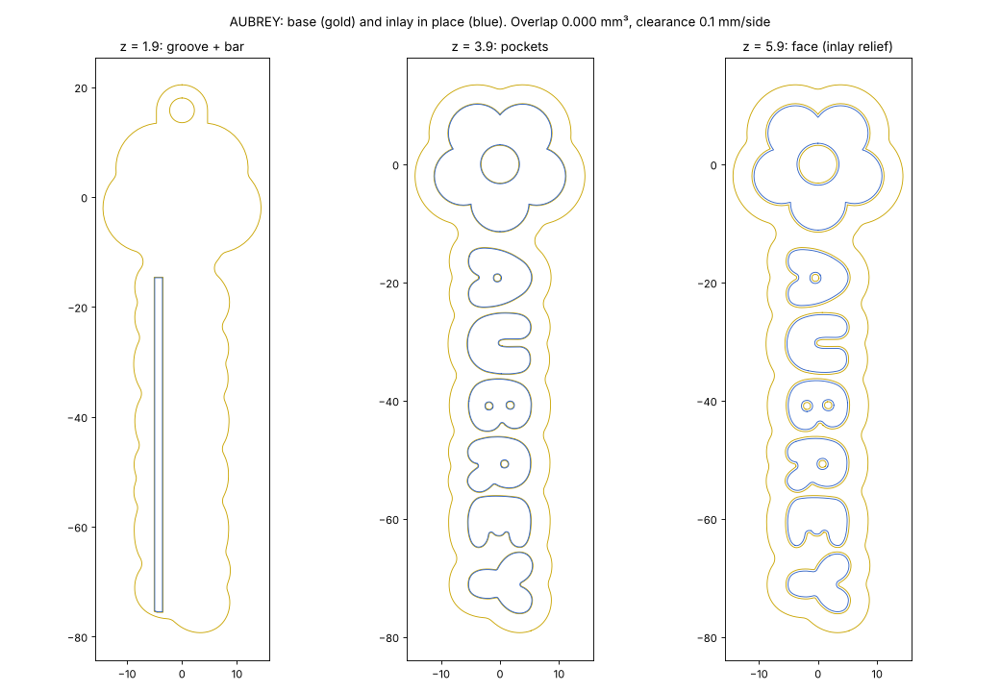
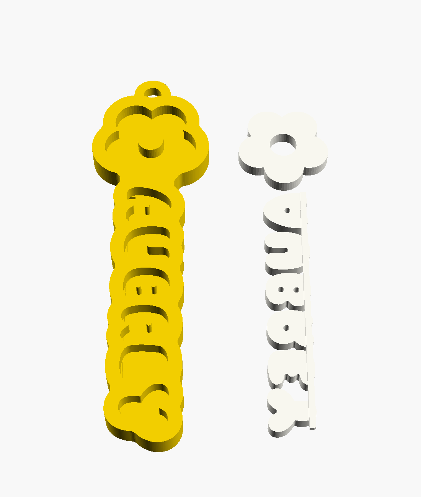

# Bag tag: name + flower, two-colour inlay — v0.1

A parametric remake of the yellow/white "AUBREY" school-bag tag: a name hanging under a five-petal flower, done as **two separate prints that press together**, so two colours work on a single-extruder MK3S+. Any name, any font OpenSCAD can see, and an optional size. The generator script (`bag_tag.py`) is also the basis for the *Bag Tag* gadget in [shiny-trinkets](https://github.com/kuraara/shiny-trinkets/tree/master/gadgets/bag-tag). Status: **v0.1, STLs and G-code ready, not printed.** 8 Nov 2026.

**3D:** [base + inlay in the viewer](https://kuraara.github.io/designing-stuff/?m=bag-tag/stl/aubrey_base.stl&m=bag-tag/stl/aubrey_inlay.stl)



## Request (verbatim)

8 Nov 2026, 13:42:

> # Bag Tags
> Since I don’t have a multi material printer, I have previously designed these bag tags using two separate models, the big one slots into the small one
>
> I think this one is 6mm thick.
>
> Do you think you could recreate something like this that is parameterised:
> - Text string
> - Font
> - Size optional, keep it roughly to the size of the one shown, included a AAA battery for scale
>
> Once that’s done, create a plan create a gadget under shiny trinkets and tell the Claude code instance to implement a web hi based on the generator scripts

Attached: four photos of the original on a school bag. It's a yellow base with a white flower and white "AUBREY" set in, a yellow flower centre, small yellow counters in A/B/R, a keyring tab at the top, and an AAA battery alongside.

Printer: Prusa i3 MK3S+. Project preference: functional over pretty, faster over perfect; TPU/PETG.

## Next step: print a test tag

1. **Base** (yellow): `gcode/aubrey_base_TPUsafe_0.20SPEED.gcode` (**49 min, 7.3 g**, TPU) or `…_PETG_…` (38 min). Prints as-is with the pockets facing up.
2. **Inlay** (white): `gcode/aubrey_inlay_PETG_0.20SPEED.gcode` (**20 min, 2.9 g**). It prints **face-down**: the letters touch the sheet and the joining bar is on top. The face of the tag therefore takes the sheet's finish (textured or smooth PEI).
3. **Assemble:** drop the flower into its pocket. For the name, line up the bar with the groove along the letters' bottom edge and press the whole name in at once.
4. **Report back:**

| Check | Pass | If not → change |
|---|---|---|
| Inlay goes in with thumb pressure and stays | snug, doesn't fall out shaken | too loose → `--set clearance=0.05` (or 0) / a drop of CA glue; too tight → `clearance=0.15` |
| Small yellow dots (~1.2 mm) in A, B, R | printed, not stringy | missing/stringy in TPU → PETG base, or `--set weld=0.65` to fill the dots in |
| Face looks flush | inlay level with the rim | proud/sunk → `inlay_proud` (+/−) |
| Size against the original | about the same | `--letter-h` / `--max-len` (below) |

**Material pairing and `clearance`** (per side, inlay smaller than pocket):
- PETG inlay in a **TPU base** (recommended: soft, can't snap on a bag, and grips the inlay): 0.1 (default).
- PETG in PETG: 0.1. It may need a drop of CA glue if your printer runs slightly under.
- **TPU inlay** in anything: 0. TPU squeezes in.

## Make one for another name

```
python3 bag_tag.py --name Mia                               # Sniglet ExtraBold, 12 mm capitals
python3 bag_tag.py --name "Zoë" --font "Titan One" --png    # + a 3D preview PNG
python3 bag_tag.py --name Maximilian --set clearance=0      # TPU inlay
python3 bag_tag.py --list-fonts                             # bundled first, then system fonts
python3 bag_tag.py --params                                 # every model parameter, with help text
```

Writes `<name>_base.stl`, `<name>_inlay.stl` (already in print orientation), `<name>_preview.svg` (top view with an AAA battery for scale), and `<name>_info.json` (sizes, checks, warnings) to `./out`. A tag takes **1–4 s**. `--preview-only` gives just the SVG and numbers in under a second.

**Size.** By default the capitals are 12 mm tall (`--letter-h`). If that makes the name longer than 62 mm (`--max-len`), the letters shrink to fit. So short names make a shorter tag, and long names a tag no longer than the original (~100 mm). `--text-size` sets OpenSCAD's raw text size and skips both.



Bundled fonts (heavy and rounded, which suits an inlay): **Sniglet ExtraBold** (default; closest to the original, including its rounded E), Lilita One, Titan One, Luckiest Guy, Chewy, Bowlby One, Bubblegum Sans. All are from Google Fonts under the SIL OFL or Apache 2.0, with the licence next to each `.ttf` in `fonts/`. Any font installed on the machine also works, e.g. `--font "DejaVu Sans:style=Bold"`. Thin fonts get a warning.

## Design

- **Two parts.** The *base* is the full 6 mm tag with pockets 3.6 mm deep above a 2.4 mm floor. The *inlay* is the flower and the letters, which fill the pockets. Letter counters (the holes in A, B, R) and the flower centre stay base-colour islands, standing on the floor.
- **One-piece name ("sprue").** The letters are separate on the face, as on the original. A hidden 1.6 × 1.0 mm bar ties them together underneath. It runs along the bottom stroke of the letters, 1.1 mm above the baseline, which keeps it clear of the counters, and sits in a matching groove in the base's floor. So the inlay is two pieces (flower + name), not a handful of loose letters.
  - The base bridges the 1.6 mm groove under the gaps between letters.
  - The inlay prints face-down, so the bar is on top and only bridges the letter gaps.
  - `--set sprue=false` gives loose letters that print face-up.
  - The generator warns if a counter would sit right over the groove, where it would print in mid-air.
- **Rim.** The rim is offset 3.2 mm from the flower and letters, then smoothed (closing r = 2), so it follows the letters with the same bumpy edge as the original. If a very big font leaves a hole inside a letter, the generator switches to `outline_style = "bar"` (a straight strip).
- **Text** reads top to bottom with letter tops facing right, like the original (`--dir up` for the other way). The text is measured by OpenSCAD itself, so it's centred exactly in any font.
- **Fit details.** `clearance` (0.1) per side. The inlay's first layer is inset 0.25 mm, so elephant foot doesn't print a lip on the face. `weld` (0.35) removes base walls and islands under 0.7 mm, which couldn't print anyway.
- **Keyring tab.** It's 3 mm thick, flush with the back, with a 4.5 mm hole centred above the flower so the tag hangs straight.
- **Print orientation:** both parts lie flat. No supports and no overhangs. The only bridges are the 1.6 mm groove (base) and the gaps between letters (inlay bar).



Sections of the AUBREY example, with the inlay put back in place:

- **z = 1.9:** the groove and the bar.
- **z = 3.9:** the pockets with 0.1 mm clearance.
- **z = 5.9:** the inset face layer.

Checked with manifold3d: the base and the placed inlay overlap by **0.000 mm³**, so the inlay can't collide with the base.

### Size vs the original

Estimated from the photo with the AAA (44.5 mm) beside the tag. The camera angle makes this rough (±10 %):

| | Original (est.) | v0.1 AUBREY |
|---|---|---|
| Overall length | ~95 mm | 99.7 mm |
| Flower width | ~29 mm | 28.8 mm |
| Name strip width | ~19 mm | 15–17 mm (bumpy edge) |
| Capital height | ~12 mm | 10.8 mm (shrunk to keep the name ≤ 62 mm) |
| Thickness | 6 mm (from the request) | 6 mm |

## Generator pipeline (`bag_tag.py`)

1. **Font check.** The font must exist (`fc-list` or bundled), because OpenSCAD silently swaps unknown fonts for a default. Every character must be in the font, checked with fontTools; otherwise the result would be empty boxes.
2. **Measure.** `part="probe"` exports the name, plus an "H", as a 2D SVG at size 10. That gives the cap height and ink box, and from them the text size: `letter_h`, capped by `max_len`. The name is then re-measured at the final size, and the ink box is passed back as `ink`.
3. **2D sections.** `outline2d`, `pocket2d`, `inlay2d` and `sprue2d` are exported (about 0.1 s each). shapely then checks for:
   - holes in the rim
   - inlay pieces
   - strokes under 0.8 mm
   - floating islands
4. **3D.** OpenSCAD reports the horizontal slabs (`part="info"`). Each slab's section (`part="slab2d"`) is extruded and unioned with **manifold3d**. The inlay is then rotated face-down (a rotation, never a mirror). Without manifold3d, the script falls back to OpenSCAD's own render, which takes about 3.5 min in 2021.01.
5. Writes the binary STLs, the preview SVG (plus an optional PNG) and the info JSON.

Dependencies:
- **Python 3:** numpy, manifold3d, shapely and fontTools. Only numpy and manifold3d matter for speed; the checks are skipped without the other two.
- **OpenSCAD 2021.01+.**
- **xvfb-run:** only for `--png`.

## Parameters (`bag_tag.scad`, or `--set key=value`)

| Group | Parameter | Default | Notes |
|---|---|---|---|
| Text | `font` | Sniglet:style=ExtraBold | `--font` |
| | `spacing` | 1.0 | letter spacing factor |
| | `text_dir` | down | `--dir` |
| | `weld` | 0.35 | closes base walls/islands < 2·weld |
| Body | `thickness` / `floor_t` | 6 / 2.4 | pocket depth = 3.6 |
| | `border` / `smooth` | 3.2 / 2.0 | rim width / outline rounding |
| | `outline_style` | follow | `bar` = straight strip |
| Flower | `flower`, `petals`, `flower_r`, `petal_r`, `centre_r`, `flower_rot`, `gap` | true, 5, 11.5, 5, 3.2, −90, 2.6 | `flower=false` for a plain name tag |
| Loop | `loop`, `loop_hole`, `loop_wall`, `loop_t` | true, 4.5, 2.4, 3 | |
| Inlay | `sprue`, `sprue_w`, `sprue_h`, `sprue_lift` | true, 1.6, 1.0, 1.1 | joining bar |
| | `clearance` | 0.1 | per side; 0 for TPU inlays |
| | `relief`, `relief_h` | 0.25, 0.2 | first-layer inset |
| | `inlay_proud` | 0 | + = raised letters |

`bag_tag.scad` also opens on its own in OpenSCAD's customizer (`part = assembly | base | inlay | plate | …`). In that case `text_size` is the raw OpenSCAD size and the centring is estimated. The 3D render is slow in 2021.01 (minutes) but works.

## Print settings and times (AUBREY)

PrusaSlicer 2.7.2 CLI: stock *Original Prusa i3 MK3S & MK3S+*, *0.20mm SPEED @MK3*, stock perimeters and infill, *Avoid crossing perimeters* on (no travel over the pockets, so fewer strings in TPU).

TPU presets come from `printer-profiles/esun-tpu95a-mk3s`:
- **TPU safe:** *eSun TPU 95A @MK3S* (conservative)
- **TPU FAST:** *eSun TPU 95A FAST @MK3S*

| Part | TPU safe | TPU FAST | PETG (Generic) |
|---|---|---|---|
| Base | **49 min, 7.3 g** | 41 min, 7.6 g | 38 min, 7.2 g |
| Inlay | 22 min, 2.9 g | 19 min, 3.0 g | **20 min, 2.9 g** |

Kept in `gcode/`: base in TPU safe and PETG, inlay in PETG and TPU safe. Times for other names scale roughly with length.



## Open questions / to verify

- **Fit** of a 0.1 mm clearance on this printer, and which pairing feels best (TPU base + PETG inlay is the guess).
- **Counter dots.** These are the ~1.2 mm yellow dots inside A, B and R, 3.6 mm tall, about two perimeters wide. They should be OK in PETG but may be stringy or missing in TPU. The original has the same dots. `--set weld=0.65` fills them in (checked on AUBREY; much higher starts joining letters). The generator warns below 1 mm.
- **"The big one slots into the small one".** The original's exact split wasn't clear from the photos. This design is a pocketed base plus an inlay. If the original was a backing plate whose raised letters push up through a holed frame from behind, say so: that split is possible too. It would give a one-piece white part without a bar, but the yellow counters would then be loose pieces.
- **Size.** The original was estimated from a photo at an angle; measure it if it matters.

## Files

| File | Purpose |
|---|---|
| `bag_tag.scad` | the model: all 2D geometry, slab sections, and OpenSCAD 3D for standalone use |
| `bag_tag.py` | generator CLI (also used by the shiny-trinkets gadget) |
| `fonts/` | bundled TTFs + their licences |
| `render_all.sh` | builds the AUBREY example: `stl/`, `img/aubrey_preview.*`, `info.json`, then `drawings.py` |
| `drawings.py` | `img/fonts.png`, `img/aubrey_sections.png` (+ the overlap check), `img/aubrey_plate.png` |
| `slice_all.py` | slices `stl/*.stl` in TPU safe / TPU FAST / PETG → `print_times.json`, keeps G-code in `gcode/` |
| `stl/aubrey_base.stl`, `stl/aubrey_inlay.stl` | the example, print orientation |
| `gcode/aubrey_*` | ready to print |

Regenerate: `./render_all.sh && python3 slice_all.py`. This needs:
- OpenSCAD 2021+, PrusaSlicer 2.7 CLI, xvfb-run and rsvg-convert.
- Python: numpy, manifold3d, shapely, fontTools, trimesh, matplotlib and Pillow.

## Changelog

- **v0.1** (8 Nov 2026): first design.
  - Two-part base + inlay, with a hidden bar joining the name into one piece.
  - Seven bundled fonts.
  - Auto sizing from letter height and maximum length.
  - Generator with manifold3d 3D: 1–4 s per tag (vs ~3.5 min in OpenSCAD 2021).
  - Rejected while building: welding the letters into one shape (r = 0.8). It joined them, but blurred them into a blob, so the hidden bar replaced it.

## Ideas for v0.2

- A shape other than a flower: heart, star, or none with the loop on the first letter.
- Horizontal layout for short names.
- A **raised-letter, single-print** variant: letters stand proud of a plate, with an M600 colour change at the plate's top layer. That's one print and no assembly, at the cost of the flat inlaid look.
- Two lines (name + class).
