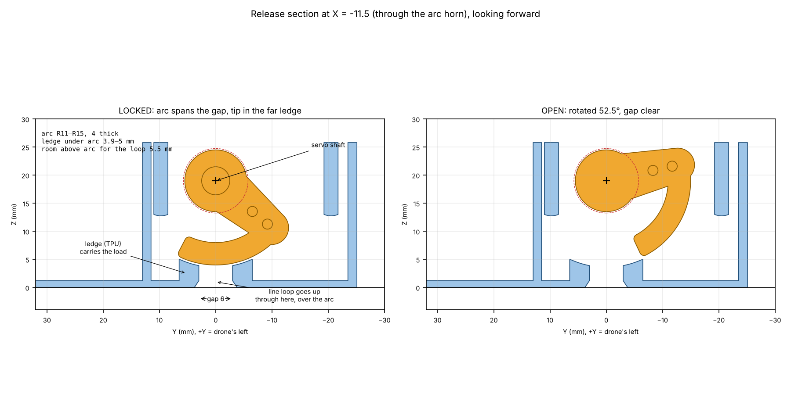

# Mavic Pro bait release — v0.1

A drone-fishing drop release for a first-generation DJI Mavic Pro. It runs on its own: an 18650 cell, an ELRS 915 (or TBS Crossfire) receiver and an ESP32-C3 drive a micro servo, so you release from a second radio rather than through the Mavic's LED. The pod sticks under the belly with heavy-duty hook-and-loop or double-sided tape. Printed in TPU, with an optional PETG horn. Status: **v0.1 designed, nothing printed. Needs belly measurements before printing (see Open questions).** 26 Nov 2026.

**3D:** [pod with servo, holder, boards and horn](https://kuraara.github.io/designing-stuff/?m=mavic-pro-bait-release/stl/tub.stl&m=mavic-pro-bait-release/stl/ref_horn_locked.stl&m=mavic-pro-bait-release/stl/ref_servo.stl&m=mavic-pro-bait-release/stl/ref_holder.stl&m=mavic-pro-bait-release/stl/ref_boards.stl) · [cut through the release](https://kuraara.github.io/designing-stuff/?m=mavic-pro-bait-release/stl/tub.stl&m=mavic-pro-bait-release/stl/ref_horn_locked.stl&cut=x&at=94) · [lid](https://kuraara.github.io/designing-stuff/?m=mavic-pro-bait-release/stl/lid.stl) · [horn](https://kuraara.github.io/designing-stuff/?m=mavic-pro-bait-release/stl/horn.stl)



## Requests (verbatim)

26 Nov 2026, 09:03:

> Design for me one of those drone fishing attachments that can be attached to a DJI Mavic Pro (first generation)
>
> Parts I have available:
> - Generic servo (but research a specific part and provide a link to purchase)
> - 18650 battery
> - a TBS crossfire receiver or ELRS 915 rx
> - ESP32 c3
> - SpeedyBee f405 flight controllers 30mm and 20mm variants)
>
> Don't go with the light sensor over the crafts LED, I'd prefer a separate system ie the crossfire or elrs and powered by the 18650
>
> Prefer TPU

26 Nov 2026, 09:16:

> For mounting point, 3M hook and loop tape (the heavy duty shit) or just double sided tape should do the job

26 Nov 2026, 09:49:

> Bare in mind that I have attached a GoPro Max to the top of a Mavic without issue so the weight isn't an issue.
>
> Did you just copy that very popular design from thingiverse?
>
> Would a linear actuator be a better option here?

Printer: Prusa i3 MK3S+. Project preference: functional over pretty, faster over perfect; TPU first, PETG sometimes.

## How it works

**Release.** The servo lies on its side with its shaft pointing at the tail. On the shaft is an *arc horn*: a curved finger (R11–R15) concentric with the shaft. Under the shaft is a 6 mm gap, open at the bottom and the back, with a TPU ledge on each side. In LOCK the arc spans the gap and its tip rests 3 mm into the far ledge. The line loop goes up through the gap and over the arc. To release, the servo turns 52.5° and the arc slides back out of the gap behind the near ledge. Stripper walls stop the loop being dragged along with it, and the loop drops out.

The loop pulls straight away from the shaft, so the ledges take the load and the servo holds no torque. It only has to overcome friction to open. This is why a 12 g servo is plenty, and why nothing drops if the servo loses power.

**Control.** Receiver → CRSF → ESP32-C3 → servo PWM. The same firmware works with ELRS and Crossfire, because both speak CRSF. The ESP32 adds what a bare PWM receiver can't:

- **Boot lock.** At power-up the servo goes to LOCK and ignores the release switch until the switch has been seen at LOCK for 0.5 s. A switch left at OPEN at power-up can't drop anything.
- **Debounce.** The switch must sit at OPEN for 100 ms before it opens.
- **Failsafe holds.** If the link drops (no channel frames for 0.3 s, or link quality 0), the servo holds where it is and never opens. If it was locked, you have to flip the switch back to LOCK before the next drop.
- **Telemetry to the radio.** The pod's battery voltage and % appear as `RxBt` and `Bat%`, and its state appears as `FM`, one of `SAFE` / `LOCK` / `OPEN`.

Loading: switch to OPEN, push the loop up into the gap, switch to LOCK.

**Why not the SpeedyBee F405s?** A full flight controller is heavier, needs 2S or more on its battery pad (or a separate 5 V feed), and would need INAV servo mixing for one switch. The ESP32-C3 does the job at 2 g.

**No-code fallback.** A Crossfire Nano RX can drive the servo directly from one of its outputs set to PWM. The same goes for an ELRS PWM receiver. You lose the boot lock and the telemetry, and the servo follows the switch through failsafe according to the receiver's failsafe setting. The pod fits either way.

## Prior art

Nothing here is copied from another model. Before designing, I read listing descriptions only, without downloading or opening any files, for:

- the Thingiverse *Low-profile Mavic Pro Electronic Bait Drop*, which clips under the body, hooks over the battery buttons, uses an SG90 servo and is triggered by a photocell on the front LED;
- Willem Jordaan's *DJI Mavic Bait Drop* (thing:3437969), which is that design's electronics basis;
- commercial releases: Gannet, BRDRC, Hanatora, STARTRC.

Every dimension in `bait_release.scad` was written from scratch for this brief: own radio and power, tape mount, TPU. The underlying idea is the standard one for drop releases: the load hangs on a pin, and a servo pulls the pin out from under the loop. Driving the pin on an arc around the servo shaft, rather than through a pushrod, is a known RC tow and drop release approach too. Expect it to look familiar.

## Release options considered

The job is to pull a pin out from under a loaded loop. The pin carries the load in the housing in every option, so the actuator only fights friction: roughly 0.5–1 × the load, so 1–3 N for a few hundred grams of bait plus some line drag.

| | Arc pin on a micro servo (v0.1) | Actuonix PQ12-R linear servo | Micro RC linear servo (Spektrum etc.) | 5 V push-pull solenoid |
|---|---|---|---|---|
| Force on the pin | ~12 N at the arc (1.6 kg·cm at R13 mm). Ample, because the servo holds no load | 18 N (30:1) to 50 N (100:1) at 6 V, less at 5 V | 0.8–3.2 N | Adafruit mini: 0.8 N, 3 mm throw. JF-0530B: 5 N/10 mm, but that's the 12 V version |
| Speed for ~10 mm | ~0.1 s | ~0.4 s (30:1) to ~1 s (100:1) | ~0.15 s | instant |
| Drive | RC PWM | RC PWM, the same firmware (1.0 ms extended, 2.0 ms retracted) | RC PWM, 3.2–4.2 V, JST-SH | MOSFET + flyback diode, ~1 A while energised |
| Holds unpowered | gearbox friction, and the load doesn't back-drive it | yes, back-drive 9–35 N | weak | only with a spring return |
| Sealing | none (ES08MA II) | IP54 | none, nylon gears | open frame |
| Cost (AU) | ~A$13 | ~A$150–300 | ~A$30–40 | ~A$8–15 |

**Verdict:** a linear actuator isn't worth it here *unless salt spray kills servos*. The arc pin already gives the main benefit of a pin-pull: the actuator carries no load. A geared micro servo does that faster and for about a tenth of the price. The tiny RC linear servos and the 5 V solenoids are too weak to pull a loaded pin reliably. The PQ12-R is the only linear option that makes sense. It is sealed, strong, holds its position, and runs off the same PWM. If the ES08MA II corrodes after a season of beach launches, the PQ12-R with a straight 2 mm stainless pin is the v0.2 swap. It would need a new bay; the electronics and firmware stay as they are.

## Next steps

1. **Check the footprint against the drone.** Print `img/footprint_1to1.pdf` at 100 % and cut it out. Hold it under the belly with the nose arrow forward and the red cross (release gap) at the balance point. Check it doesn't cover the downward vision cameras or ultrasonic sensors, and note what it overlaps. Then answer the open questions below; they may move the gap or change the size.
2. **Order the parts** (BOM below). The servo is the only thing you don't have.
3. **Print.** The horn takes 7 min, the lid 58 min and the tub 2 h 44 min (TPU FAST), or 3 h 16 min on the conservative TPU preset.
4. **Bench build:** wire it up, flash it, calibrate the servo, and run the load test (sections below).
5. **First flights** over land, with a dummy weight on a loop. Check the compass bars in DJI GO 4 with the pod fitted (Open questions).

## BOM

| Part | Pick | Notes |
|---|---|---|
| **Servo** | **EMAX ES08MA II**, 12 g, metal gear, 4.8–6 V, 1.6/2.0 kg·cm, 23 × 11.5 × 24 mm | [GetFPV (in stock 26 Nov)](https://www.getfpv.com/electronics/servos/emax-es08ma-ii-12g-mini-metal-gear-analog-servo-for-rc-model.html) · [FPV Faster AU, A$12.99 (sold out 26 Nov)](https://www.fpvfaster.com.au/products/emax-es08-ma-ii-mini-metal-gear-analog-servo). Same day in Perth: [Altronics Z6444 MG90S](https://www.altronics.com.au/p/z6444-mg90s-metal-geared-micro-servo/), A$13.95. The servo slot fits both. Metal gears, because a plastic-gear servo strips in a crash. |
| 18650 cell | yours | Flat or button top. Cell + holder ≈ 53 g, the heaviest thing on the pod. |
| 18650 holder | Jaycar **PH9205** (76 × 22 × 21, leads) or [SparkFun PRT-12899 at Core](https://core-electronics.com.au/battery-holder-1x18650-wire-leads.html) (74.5 × 21.5 × 17.7) | The compartment is 77.5 × 22.6. |
| Charger | TP4056 **USB-C with protection** (DW01 + 8205A; 6 pads: B+ B− OUT+ OUT− IN+ IN−), ~28 × 17 mm | Its USB-C port lines up with the front-wall opening. The protection cuts out around 2.5 V. |
| 5 V boost | MT3608 module (36 × 17 mm) | **Set it to 5.0 V with the trim pot before connecting anything.** It should cope with the servo's stall current from one cell. |
| Switch | SS12D00 slide switch (8.5 × 3.7) | In the −Y (drone's right) wall window. Hot-glue it inside. |
| Receiver | ELRS 915 RX **or** Crossfire Nano RX (yours) | CRSF on two pins, powered from 5 V. |
| Controller | ESP32-C3 SuperMini (yours) | Sits under the servo. |
| Resistors | 2 × 100 kΩ | Battery divider. |
| Screws | 4 × M3 × 10 countersunk (lid; they self-tap into the TPU bosses), 1 horn screw with the same thread as the stock one but ~8 mm long (usually M2), 2 servo screws | |
| Mount | 3M Dual Lock SJ3550 / heavy-duty hook-and-loop, or 3M VHB double-sided | See Mounting. |
| Tether | ~30 cm of 30 lb braid | Safety line from the lid's eyelet to the drone. |

## Wiring

```
18650 + ──── TP4056 B+                     TP4056 OUT+ ── switch ── MT3608 VIN+ ──┬── 100k ──┬── 100k ── GND
18650 − ──── TP4056 B−                     TP4056 OUT− ──────────── MT3608 VIN−   │          └── ESP32 GPIO3
                                                                                  (divider after the switch,
MT3608 VOUT+ (5.0 V) ── servo red ── ESP32 5V ── RX 5V                             so it draws nothing when off)
MT3608 VOUT−         ── servo brown ── ESP32 GND ── RX GND

RX "TX" (CRSF out) ──► ESP32 GPIO20        ESP32 GPIO4 ──► servo signal (orange)
RX "RX" (CRSF in)  ◄── ESP32 GPIO21        (telemetry; leave it off if you don't want it)
```

Charging: plug USB-C into the TP4056 port at the front. It charges with the switch on or off. Red LED means charging and blue means full; the LEDs aren't visible through the wall, so go by time (about 3 h at 1 A for a 3000 mAh cell).

Layout (see `img/pod_drawing.png`): the TP4056 lies flat at the front of the electronics bay, on the cell-wall side, with its USB-C port against the front wall (a 2 mm stop behind it locates it). The MT3608 lies flat beside it on the outer-wall side. The ESP32-C3 and RX go under the servo. Wrap the boards in Kapton and pack them with a little foam or hot glue. The RX antenna leaves through the hole in the drone's-right wall: run the T-antenna legs down and back, away from the props. Holder leads go over the cell wall through the two notches.

Power draw (estimate, not measured): around 0.5 W in total, so roughly 15–20 h powered on from a 3000 mAh cell.

## Firmware (`firmware/`)

`bait_release/bait_release.ino` opens as-is in the Arduino IDE (board *ESP32C3 Dev Module*, *USB CDC On Boot: Enabled*, Arduino-ESP32 core 2.x or 3.x). Or use PlatformIO: `cd firmware && pio run -t upload`. The settings are `#define`s at the top:

| Setting | Default | |
|---|---|---|
| `RELEASE_CH` | 6 | release switch channel (1-based) |
| `ARM_CH` | 0 (off) | optional second switch that must also be HIGH to open |
| `LOCK_US` / `OPEN_US` | 1250 / 1850 | servo end points, **calibrate** |
| `CRSF_BAUD` | 420000 | ELRS default; also fine for Crossfire |
| `VBAT_TRIM` | 1.00 | scale to match a multimeter |

The USB serial monitor (115200) prints the state, the channel values, the LQ and the voltage once a second.

**Tested:** the CRSF decode, CRC, state machine, failsafe and telemetry framing all run on a PC against a stand-in Arduino layer (`firmware/test`, `g++ -std=c++17 -I. test_logic.cpp -o t && ./t`): 18/18 checks pass. **Not done:** an on-device build. The ESP32 toolchain couldn't be downloaded in the build environment, so do the first compile in the Arduino IDE, which will also catch API slips.

**Radio setup**

- Use a separate model on the radio for the pod. Put a **2-position switch** on CH6. A momentary button also works, but then you have to hold it while loading.
- ELRS: flash and bind the RX with the **AU915** regulatory domain to match your TX module. Serial protocol: CRSF (the default).
- Crossfire Nano RX: set the two pins you wire to **CRSF TX / CRSF RX** in the output map (Lua or Agent), and make sure the module and RX are on the Australian 915–928 MHz setting.
- Telemetry → *Discover new*. You should get `RxBt`, `Bat%` and `FM`. Put a low-voltage alarm on `RxBt` at 3.4 V.

## Assembly and calibration

1. **Horn.** Print it in PETG if you can. It's stiffer and slides better than TPU on TPU, which keeps release friction low under load. TPU works too. Press the servo's **single-arm horn** into the pocket on the horn's flat face. Fix it with the longer horn screw through the centre and, if the arm holes line up, two small screws or wire ties through the spoke holes.
2. **Set the end points with the horn off.** Power up, connect the radio and flip the switch to LOCK (the LED goes from fast blink to a slow blip). The servo is now at `LOCK_US`. Fit the stock arm on the spline as close as you can to this position: looking forward from behind the pod, the arm points down and to your right, 50° from straight down (`a_spoke`). Then fit the horn.
3. Flip to OPEN. Seen from behind, the horn should turn **anticlockwise** (the arc tip moves from your left to your right). If it turns the wrong way, swap `LOCK_US` and `OPEN_US`.
4. Trim in 10–20 µs steps. When **locked**, the arc tip should sit about 3 mm into the far ledge with no buzzing. If the servo buzzes against the ledge, back `LOCK_US` off. When **open**, the tip should sit fully behind the near stripper wall, so nothing of the arc shows in the gap from below.
5. Drop the servo into the bulkhead slot with the horn already on, in the open position. The slot and the ledges are open on top for this. Screw the servo tabs to the bulkhead.
6. **Load test on the bench.** Hang about 500 g (a water bottle) from a loop of your drop-loop material in the gap and release it 20 times. Then hold the pod upside down and shake it while locked. The loop must stay in. After the test, the ledges shouldn't have taken a set.
7. Fit the lid (4 × M3 countersunk). The heads sit flush in the tape face.

## Mounting

- The **tape face** is the lid's top. It's flat because it's printed face-down on the sheet. Scuff it lightly and wipe the lid and the belly with isopropyl alcohol. Adhesives grip TPU less well than hard plastic.
- **Where:** put the red cross on the footprint (the release gap) at the drone's front-to-back balance point, or up to 5 mm behind it. Keep it on the centreline (the gap is 6 mm to the drone's right of the pod's centre, by design). With the pod alone, its centre of mass is about 32 mm ahead of the gap (estimate). Fitted with the gap at the balance point, that moves the whole drone's balance point about 4–5 mm forward, which the Mavic copes with easily. A bait hanging at the gap pulls it back.
- **Don't cover** the downward vision cameras, the ultrasonic sensors or any vents. The Mavic Pro's downward vision system (cameras plus ultrasonic sensors) is on the belly, and the gimbal is in front of it.
- Let the adhesive cure 24 h before the first loaded flight.
- **Tether:** tie the eyelet at the front of the lid to the drone (around an arm root or a front leg) with a short loop of braid. A pod that peels off then hangs instead of going in the water.

## Print settings and times (v0.1)

PrusaSlicer 2.7.2 CLI, stock *Original Prusa i3 MK3S & MK3S+*, *0.20mm SPEED @MK3*, **Perimeters = 4**, *Avoid crossing perimeters* on. TPU presets from `printer-profiles/esun-tpu95a-mk3s`. No supports on any part.

| Part | Orientation | TPU FAST | TPU safe | PETG |
|---|---|---|---|---|
| `tub` | open side up | **2 h 44 min, 28.8 g** | 3 h 16 min, 28.1 g | 2 h 41 min, 27.5 g |
| `lid` | tape face on the sheet | **58 min, 13.0 g** | 75 min, 12.6 g | 44 min, 12.4 g |
| `horn` | pocket face up | 6 min, 0.9 g | 7 min, 0.9 g | **7 min, 0.9 g** |

G-code in `gcode/`: tub and lid in TPU FAST and TPU safe, and the horn in PETG and TPU FAST. 0.30 DRAFT saves 30 min on the tub in TPU (the rest are in `print_times.json`). If the FAST walls come out gappy, switch to the safe G-code.

Overhang check: the only downward faces are the 6 mm rear-notch bridge, the switch window, the small round holes, and the 45° cones under the lid-screw bosses. The USB-C opening has a 45° pointed top.

## Weight

| | g |
|---|---|
| Printed (tub, lid, horn) | 43 |
| 18650 + holder | 53 |
| Servo | 12 |
| Boards, wires, switch, screws | ~14 |
| **Pod, estimated** | **~122** |

**Weight is not a design driver.** The owner has flown a GoPro Max on top of a Mavic without trouble (26 Nov). The figures stay here for reference only. The Mavic Pro weighs 734 g as standard and DJI publishes no payload figure. The Gannet release's listing says the Mavic Pro can carry 400–450 g at most and doesn't recommend more. One Mavic forum owner who logged current draw suggests staying under about 300 g. Flight time drops with every gram.

## Key numbers (all in `bait_release.scad`)

| Parameter | Default | Notes |
|---|---|---|
| Pod | 80.7 × 62.3 × 27.8 | L × W × H with the lid |
| `gap` | 6 | loop gap. The loop must pass through 6 × 17 mm |
| `arc_ri` / `arc_ro` / `arc_t` | 11 / 15 / 4 | arc pin |
| `engage` / `open_clear` | 3 / 2.5 | tip into the far ledge / behind the near stripper → travel **52.5°** |
| `a_spoke` | −50° | spoke angle when locked (0 = straight down) |
| `zs` | 19 | shaft height. Ledge under the arc is 3.9–5.0 thick |
| `horn_face_x` | −9.5 | **measure:** `3 − (servo tab top face → outer face of the fitted stock arm)`. MG90S ≈ 12.5 mm → −9.5. The horn has ±2 mm of room in X. |
| `wall` / `floor_t` / `lid_t` | 1.6 / 1.2 / 2.0 | |
| `cell_len` × `cell_w` | 77.5 × 22.6 | 18650 holder bay |
| `usb_*`, `sw_*`, `ant_*` | | front USB-C opening, switch window, antenna hole |

Coordinates: X forward, Y to the drone's left, Z up; Z = 0 is the pod's bottom face. The servo shaft is at Y = 0, Z = 19, and the gap is centred at X = −11.5.

`sweep_check.py` (run by `render_all.sh`) checks that the horn turned through its whole travel never touches the tub (0.40 mm clearance locked, 0.67 open), that the arc spans the gap when locked and is clear of it when open, and that the servo, holder and boards fit. All pass for v0.1.

## Open questions / to verify

1. **Belly.** How much flat, sensor-free belly is there behind the gimbal: length, width, and where it sits relative to the balance point? The footprint printout answers most of this. If the downward sensors are where the pod wants to go, the choice is to turn *Vision Positioning* off in DJI GO 4 (it's unreliable over water anyway), or to move or shrink the pod.
2. **Take-off and landing.** The pod hangs 28 mm under a drone that already sits very low. Do you hand-launch and hand-catch, or do you want leg extensions? The PGYTECH set adds 35 mm, but its rear piece goes under the belly and may clash; printed TPU legs could be v0.2.
3. **Which receiver** you'll use: the ELRS 915 is lighter, and the antenna exit assumes a T-antenna.
4. **Drop loop.** What do you tie in: mono, braid, a rubber band, copper wire? The gap is 6 mm wide with 5.5 mm above the arc. Bulky loops would need a bigger `gap`.
5. **Servo dimensions.** Measure your servo's tab-to-horn distance and set `horn_face_x` before printing. Tab height and body width vary a little between ES08MA II and MG90S; the slot is sized for both.
6. **Compass.** The 18650's steel can and the servo magnet sit a few cm under the body. A DJI forum report puts the Mavic Pro's compasses near the bottom of the legs. With the pod fitted, check *Sensors → Compass* in DJI GO 4 and recalibrate the compass with the pod on.
7. **Rules.** CASA's page on dropping items from aircraft says drones have separate rules. Check the current drone rules before fishing with it.

## Files

| File | Purpose |
|---|---|
| `bait_release.scad` | parametric model. `part = tub, lid, horn, assembly, ref_*, horn_place, sweep_check, info` |
| `render_all.sh` | renders the STLs, `info.json`, previews, the sweep check and the drawings |
| `sweep_check.py` | horn-vs-tub collision, gap and fit checks |
| `slice_all.py` | PrusaSlicer CLI slicing → `print_times.json`, kept G-code in `gcode/` |
| `drawings.py` | `img/release_section.png`, `img/pod_drawing.png`, `img/footprint_1to1.pdf` |
| `stl/tub.stl`, `stl/lid.stl`, `stl/horn.stl` | print files, in print orientation |
| `stl/ref_*.stl` | servo, holder, boards and the horn in place (viewer only) |
| `firmware/bait_release/bait_release.ino`, `firmware/platformio.ini` | ESP32-C3 firmware |
| `firmware/test/` | host-side logic test |

Regenerate: `./render_all.sh && python3 slice_all.py`. Needs OpenSCAD 2021+, xvfb-run, PrusaSlicer 2.7 CLI, and Python trimesh, manifold3d, shapely and matplotlib. The tub renders in about 20 s.

## Changelog

- **v0.1 docs** (26 Nov 2026): weight dropped as a constraint, per the owner. Added *Prior art* and *Release options considered* (linear actuator, solenoid). No geometry changes.
- **v0.1** (26 Nov 2026): first design. Started as a strap-on pod, then switched to tape or hook-and-loop on a flat lid after the 09:16 message. Rotary arc-pin release, ESP32-C3 CRSF firmware with boot lock, failsafe hold and telemetry. Walls trimmed to 1.6 mm, the floor to 1.2 mm and the lid to 2.0 mm, saving ~10 g and ~30 min against the first render.

## Ideas for v0.2

- Move the gap nearer the pod's centre of mass (servo in the middle, holder split around it).
- Lid with windows between the tape areas (−5 g, −20 min).
- Printed TPU leg extensions sized to clear the pod.
- A light pipe or window for the ESP32's status LED.
