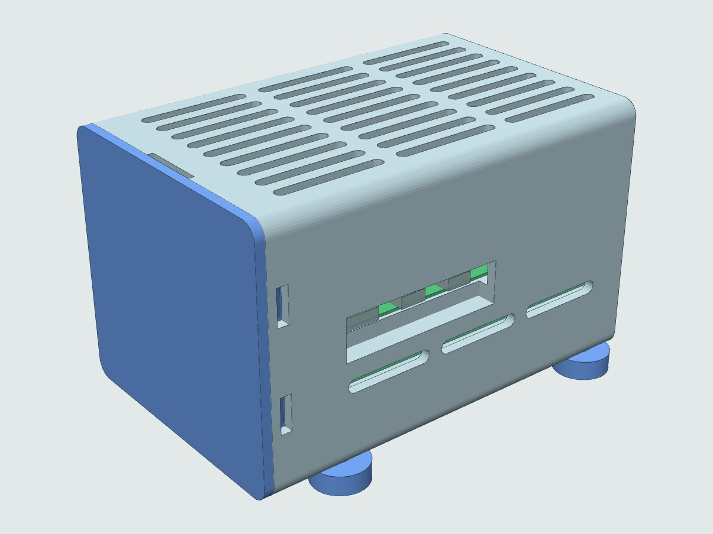
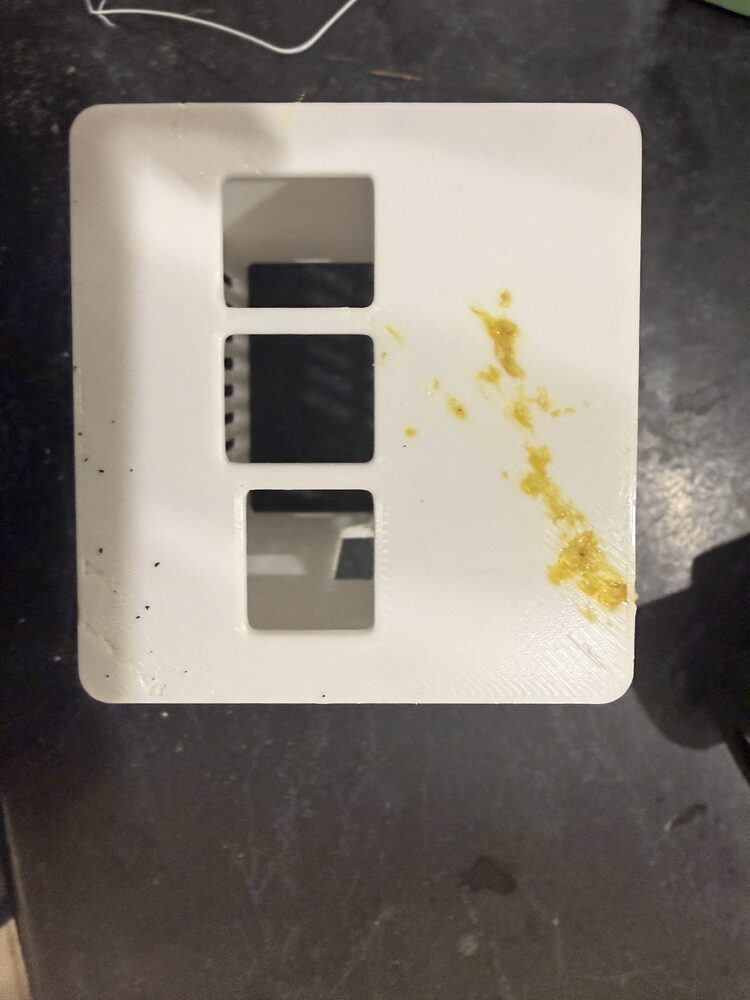
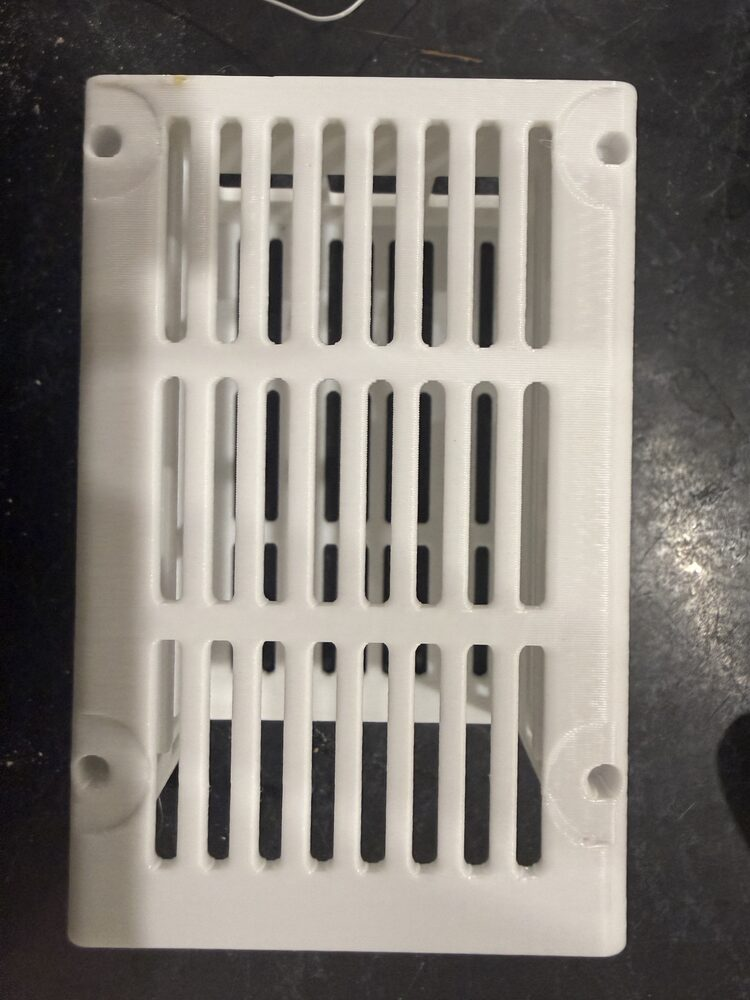
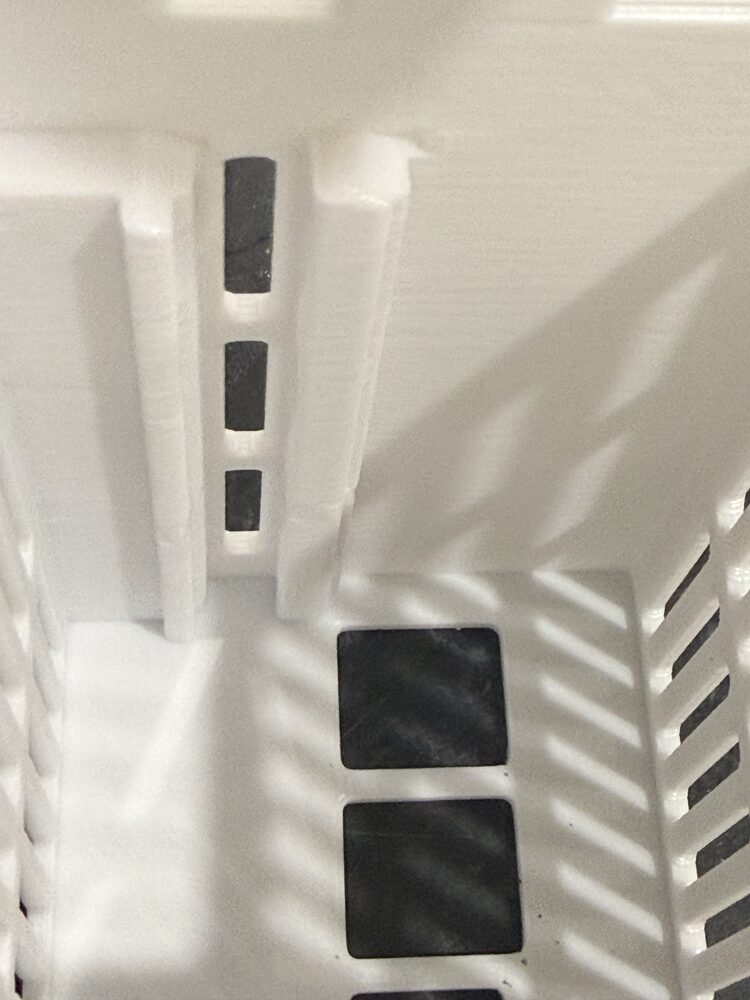
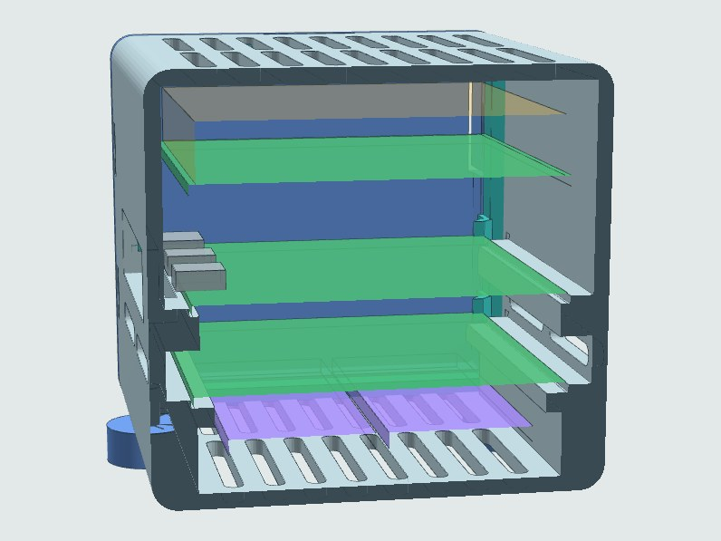
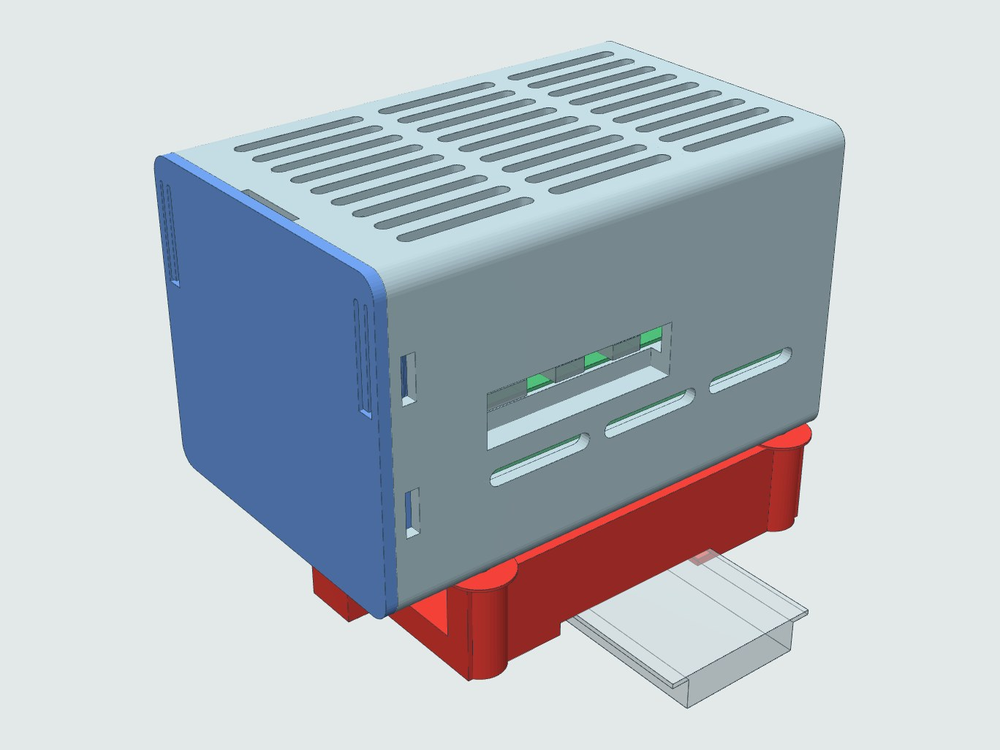
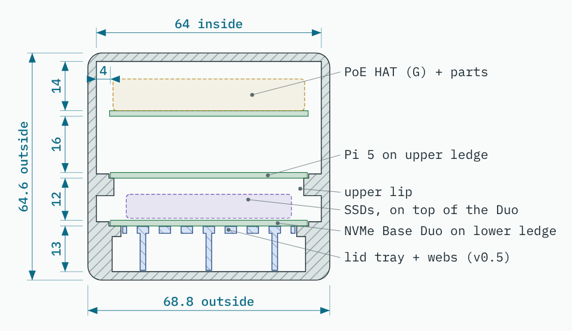
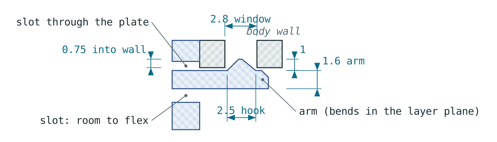

# Pi 5 PoE NVMe Case — enclosure v0.3

Slide-in "tube" case for a Raspberry Pi 5 + Waveshare PoE HAT (G) + Pimoroni NVMe Base Duo. No screws or standoffs in any board: each board rests on its own ledge. One parametric OpenSCAD file.

Status (11 Nov 2026, v0.3): **body printed and working; lid redesigned, to reprint in PLA.** The body (v0.2, unchanged; printed 10 Nov in PLA) printed well and its ledges hold the NVMe Base Duo through a shake test. The v0.2 TPU lid's snap bumps printed as faint nubs, so v0.3 replaces them with two flexing latch arms in a PLA lid that click into the body's existing upper side windows. **Reprint only the lid.** Feet and DIN bracket are unchanged.

## Print it

**Printed 10 Nov 2026:** the body, in PLA rather than PETG: stock *0.30mm DRAFT @MK3* with *Generic PLA* (215 °C / bed 60), 4 h 22 m, 75 g, sliced by PrusaSlicer 2.7.2 CLI the same way as `slice_all.py`. The owner said it printed fine. Board fit, the lid (TPU) and the feet aren't tested yet.

| USB end (printed on the bed) | Floor | Inside |
| --- | --- | --- |
|  |  |  |

The yellow on the USB end is leftover filament from the previous print, pressed into the first layers (nozzle and sheet weren't cleaned first); it's cosmetic. The jack cut-outs, vents, foot counterbores and the board ledges all came out clean at 0.30 mm layers.

**11 Nov 2026:** boards fitted. The ledges hold the NVMe Base Duo through a shake test. The v0.2 TPU lid printed, but its snap bumps came out as faint nubs, so the lid is redesigned for PLA (v0.3, below). The body stays as printed.

| File | Material | Orientation (already set) | Time |
|---|---|---|---|
| [`print/pi5_case_body_PETG.stl`](print/pi5_case_body_PETG.stl) | PETG (PLA works: printed 10 Nov, 4h 22m) | USB end on the bed | 4h 26m, 77 g |
| [`print/pi5_case_lid_PLA.stl`](print/pi5_case_lid_PLA.stl) | **PLA** (PETG also fine), 0.20 mm SPEED | outer face down | 58m, 14 g (PETG 1h 01m) |
| [`print/pi5_case_feet_x4_TPU.stl`](print/pi5_case_feet_x4_TPU.stl) | TPU, eSun 95A FAST | counterbore up (fit them turned over) | ~15m, 4 g |
| [`print/pi5_case_din_bracket_PETG.stl`](print/pi5_case_din_bracket_PETG.stl) | PETG, 4 perimeters, 40% gyroid | rail side down | 2h 24m, 43 g |

Body, feet and bracket at 0.30 DRAFT. No supports. Feet **or** DIN bracket, not both. Fit the microSD card before the PCIe ribbon (the ribbon covers the slot).

[`print/pi5_case_design.pdf`](print/pi5_case_design.pdf): 15-page design pack (drawings, 3D views, print and assembly notes, brief) with the four STLs embedded as PDF attachments.

Online: [drawings page](https://claude.ai/artifact/S3LdNWXs8CYuMMDd2AhQnt) (private to the owner) · [3D viewer](https://claude.ai/artifact/GdAqqBgVog6yVpPGcgRbWo) (anyone with the link). The same pages are in this folder as `pi5_case.html` and `pi5_case_viewer.html`.

| | |
|---|---|
|  |  |
| Section: Pi on the upper ledge, NVMe Base Duo on the lower ledge | On a TS35 DIN rail via the bracket |

## Brief (verbatim, 1 Nov 2026)

> Let’s make a raspberry pi 5 case. Requirements:
> - it has a PoE hat (check my Gmail inbox for order confirmations from Core Electronics for the part number)
> - it has a pimoroni dual nvme base
>
> I want to avoid screw holes, I would prefer. Refer to this sketch of the side profile showing how I would like the pi and the nvme base to sit on a lip
>
> The nvme base will need enough vertical clearance from the pi to account for thick nvme disks (dual Samsung 1TB)
>
> For the USBC port, it will need enough clearance to account for fairly chunky usb connectors like the ones on dell thunderbolt docks
>
> Previous designs I have made use. 3mm walls but that’s not a hard requirement. If strength can be gained through smart use of webbing and structural ribs then that would be ideal if print time can be optimised
>
> Printing in 2-3 parts would be ideal,
> - main body
> - lid
>
> If the lid is on the smallest face (the usb/rj45 end) or the sd card  end that would be ideal. The pi can slide in like into the case as if it were a tube
>
> Attaching the end pieces “lids” can wither be screw in (m3, counter bore heads, or a nice click in place) for a screwless click in place I would print that from TPU to allow for some flex with whatever you use, and it can still retain some rigidity
>
> Give it ventilation holes top and bottom, you can increase the space between the inner walls and the nvme base/poe hat as they tend to generate a bit of heat
>
> It will also need some feet that can be screwed in with m3  counterbored screws
>
> Make some sort of tray for the as card so it can be slotted in and out like a SIM card
>
> I think those are all the requirements for now
>
> Create 2d projections before the 3d model

**Sketch (attached image, described):** side profile of one wall. Thin upper wall; below it the wall steps inward into a solid lip; the Pi box rests on the lip top, overlapping it; below the lip the wall steps back outward, ending thicker than the upper wall.

## Follow-ups (verbatim, 1 Nov 2026, after v0.1)

> I’d prefer the cross section be like this  *(second sketch attached)*
>
> I don’t want to screw into the pi or the nvme base, the idea is for this to be simple
>
> Alright skip the sad card holder stuff

**Second sketch (described):** one wall in section. Upper lip with the Pi resting on its top; below it the wall steps out into a recess where the NVMe board's edge runs; a lower lip the NVMe board rests on; below that the wall steps back out (less far than the recess).

> 1. Samsung 980EVO
> 2. No idea
> 3. Not fussed, the gpio pins hold it in pretty snugly

(Answers to: which SSDs / actual HAT height / add HAT hold-down ribs.)

Changes for v0.2: standoffs and Duo screws dropped, each board on its own ledge (upper lip between the boards); SD tray and microSD-extension sleeve removed; USB-end jaws removed (boards stop on the end wall); lid prongs now push both boards; side vents added in the recess between the lips.

Printer: Prusa i3 MK3S+. Project preference: functional over pretty, faster over perfect; TPU/PETG preferred.

## Print test and lid v0.3 (11 Nov 2026)

Messages (verbatim, 11 Nov 2026):

> The case printed well, the little tabs on the lid did not print at all

*(5 photos: the yellow TPU lid edge-on showing the prongs and only faint nubs where the snap bumps should be; inside the white body showing the ledges and side windows; the floor with vents and feet bosses; the USB/RJ45 end.)*

> PLA might be able to do the job if you make the tabs thin enough to flex a little

> The rails are doing a good job of securing the nvme base

*(2 photos: the NVMe Base Duo sitting on the lower ledges, PCIe connector clear; the lid's TPU prongs printed with stringy roots.)*

> I can shake the case and the base is secure

**Why the TPU bumps failed.** Slicing the v0.2 lid with the TPU preset (0.30 mm layers) and measuring the toolpath: the bumps *were* in the G-code, but they stood only 0.04 → 0.79 → 0.13 mm proud over about five layers, which TPU smoothed away. Even printed perfectly, only 0.55 mm of a 0.8 mm bump (after the 0.25 mm fit gap) would have reached into the windows. Too small for TPU.

**v0.3 lid (body unchanged):**

- PLA (or PETG), rigid. One flexing **latch arm** per long side: 19.1 mm of skirt cut free by slots through the lid plate (1.2 mm inside, 0.8 mm outside, 1.0 mm across the free end), fixed at its top end. Arm 1.6 mm thick; it bends sideways, in the layer plane, so PLA flexes along its filaments. Root to hook 14.1 mm, deflection 0.75 mm to pass the wall, strain ≈ 0.9%.
- Hook 1 mm high × 8 mm wide, 45° retaining face (prints as a 45° overhang), ~40° lead-in; sits in the body's **upper** side window (2.8 × 9) with 0.2/0.1 mm clearance along X and 0.5 mm each side in Z; 0.75 mm reaches into the 2.4 mm wall. The lower windows are now vents (they line up with the Duo prongs, so no arm fits there).
- Toolpath check (PLA, 0.20 SPEED): the hook bulge reaches the full 0.99 mm and spans 12 layers; the 0.8 and 1.2 mm slots have no extrusion on layers 1–2.
- Skirt leading edge chamfered 0.6 mm to ease a rigid lid into the mouth.
- Prongs now stop 0.2 mm short (`prong_tip` 0.6 → 0.3): a rigid lid can't take the old 0.1 mm preload. The ledges already hold the boards.
- Assembled: lid ∩ body = 0, lid ∩ boards = 0. During insertion only the hooks overlap the wall, which the arms flex past.
- To open: pull at the body's thumb notch; if tight, press the hooks in through the side windows with a small screwdriver.

Tuning: `latch_t` (arm thickness, softer at 1.2) and `latch_hook` (hook height, firmer at 1.2). Both only need a lid reprint.

## Feet v0.4: suit M3 × 8 button heads (11 Nov 2026)

Message (verbatim, 11 Nov 2026, with two photos of a button-head screw in calipers):

> Can you confirm your design of the feet suit these screws

The caliper display was off; the beam scale reads ≈10 mm overall, i.e. an **M3 × 8 button head** (ISO 7380, head Ø5.7 × 1.65).

**v0.2 feet did not suit it** (design error): the foot left 1.8 mm of TPU under the head, so 6.2 mm of screw entered the case, but the insert hole is only 5.4 mm deep below the 0.6 mm foot recess (shorter than the 5.7 mm insert itself). The screw would bottom out 0.8 mm before clamping.

v0.4 stack-up (z = 0 at the case bottom; foot top sits in the recess at z = 0.6):

| | z |
|---|---|
| head seat (foot 6 tall, 3.0 counterbore → 3.0 mm TPU under the head) | -2.4 |
| screw tip (M3 × 8) | 5.6 |
| insert end (M3 × 5.7, pressed flush with the recess floor) | 6.3 |
| hole end, printed v0.2 body / new bodies (`insert_depth` 6.5 below the recess) | 6.0 / 7.1 |

5.0 mm of thread in the insert; the head sits 1.35 mm below the foot's face. On the printed body, press the inserts flush with the recess floor; the last 0.3 mm melts into solid plastic above the 5.4 mm hole, which is fine. The DIN bracket's M3 × 20 (button or socket head) ends at z = 5.0: 4.4 mm in the insert, no change needed. The model now `assert`s that the foot screw can't bottom out.

## Parts identified

| Part | Source |
|---|---|
| **Waveshare Power Over Ethernet HAT (G) for Raspberry Pi 5 (5V 5A)**, SKU **WS-27670** | Core Electronics order #1000592941, 13 Mar 2025 (Gmail). Same order: Raspberry Pi 5 Model B 4GB (CE09785), Raspberry Pi 5 Active Cooler (CE09791) |
| Pimoroni NVMe Base Duo, PIM704 | User. Kit: 4 × 12 mm M2.5 standoffs, short M2.5 bolts, 5 mm M2 SSD standoffs, PCIe flex |

Known data: HAT (G) 64.98 × 56.5, no fan, compatible with the Active Cooler (Waveshare). Duo 85 × 56, fits under the Pi on 12 mm standoffs, SSDs face away from the Pi (underside), two M.2 slots side by side (2230–2280), FFC moved to the middle of the SD-end edge; the ribbon blocks the Pi's microSD slot (Tom's Hardware, Pimoroni). Pi 5 port centres from its mechanical drawing: USB-C 11.2, micro HDMI 25.8 / 39.2 along the long edge; Ethernet 10.2, USB 29.1 / 47 across the USB end.

## DIN rail bracket (added 1 Nov 2026)

Request (verbatim):

> Let’s create another component that uses the footprint of the feet to attach it to the case.
>
> It will be a bracket to mount it on a DIN rail
>
> Leave plenty of clearance for the airflow, make sure the bracket is sturdy and rigid as people may be rough installing and removing it

Design (`part = "din"`, `"din_asm"`, `"din_rail"`; parameters under `[DIN rail bracket]`):

- Bolts to the four foot inserts in place of the feet: 4 × M3 × 20 socket heads through counterbored bosses (5.4 deep counterbore leaves 5 mm in the insert). Boss tops have a spigot that sits in the foot recess.
- TS35 rail (35 × 7.5 or 35 × 15) runs **across** the case, so the case stands with its length vertical: 69 mm (4 modules) along the rail. The bolt pattern is symmetric about the bracket centre, so the case bolts on USB-end-down (cables hang) or up.
- Airflow: 14 mm air gap (`din_gap`) between the bracket plate and the case floor, forming a vertical chimney behind the floor vents; side ribs sit under the case's thick lower walls, clear of the vents; open window and flexure gaps in the plate.
- Rigidity: 6.4 mm plate, two 20.4 mm side ribs along the full length, gussets along the spine, rail contact spread across the full 68 mm width.
- Clip: fixed hook on one flange, full width, 3.2 mm under the flange. Latch on the other flange: head 24 mm wide, 1.5 mm under the flange, lead-in ramp so it snaps on; carried by two 1.0 mm flexure beams (≈21 mm free span each side, ~29 MPa at full travel in PETG). Over-travel stop at 2.2 mm (release needs 1.75), and even at the stop the fixed hook still has 0.75 mm of engagement. Pull tab with a screwdriver slot.
- Print: PETG, rail side on the bed, flexures in-plane (they bend within layers). The rail pocket's ceiling is a ~36 mm bridge over the rail channel; sag there touches nothing. Draft profile 1h 39m / 31 g; recommended 4 perimeters + 40% gyroid: 2h 24m / 43 g.
- Stand-off: case floor 25.1 mm from the wall, case front 89.7 mm from the wall.
- Not yet printed; check the latch feel and the snap on a real rail first.

## Architecture

| Part | Material / orientation | What it does |
|---|---|---|
| **Body** | PETG, USB end on the bed (tube vertical) | Closed USB/RJ45 end with jack cut-outs; upper and lower lips along both long walls; thick SSD-bay walls below the lower lip; USB-C/HDMI window; roof, floor and side vents; snap windows at the mouth; feet inserts |
| **Lid** (v0.3) | PLA or PETG, 0.20 mm, outer face on the bed | Click-in at the SD end: chamfered skirt + 2 flexing latch arms whose hooks click into the upper side windows; 3 prongs locate the boards (both Duo corners, the Pi's GPIO-side corner) |
| Feet × 4 (v0.4) | TPU, flat, counterbore up | Ø14 × 6, Ø6.4 × 3.0 counterbore (faces the desk when fitted), M3 × 8 button or socket head into heat-set inserts |

**How the boards are held (no screws, no standoffs):** each long wall has two lips (user's second sketch). The Duo rests on the lower ledge (3 mm reach); the Pi rests on the upper ledge (1 mm reach), and the upper lip sits in the 12 mm gap between the boards. A 1.2 mm fence on each ledge (below PCB thickness) locates each board sideways with 0.4 mm play a side. The PCIe ribbon is the only link between the boards. They slide in together from the SD end, USB first, and stop on the closed USB end wall; the lid prongs locate them with 0.2 mm of end play (v0.2 had a 0.1 mm preload from the TPU lid). The HAT is held by its GPIO + PoE headers only.

**Why the Pi's ledge is only 1 mm:** the GPIO solder joints and the USB/RJ45/USB-C/HDMI shell tabs on the Pi's underside start about 1.4 mm in from the long edges.

**Port window notch:** a chunky USB-C overmold hangs ~2 mm below the Pi's board edge. Along the window (x 3.2–45.2) the upper lip's outer half (beyond 1.4 mm outside the board edge) drops 2.5 mm; the 1 mm ledge under the Pi continues, tied to the wall below the notch.

**Power button:** Pi 5's button sits next to the USB-C, so the lid has no prong on that corner of the Pi.

Coordinates in the SCAD: board-aligned. X = 0 at the boards' SD edge, 85 at the USB edge; Y = 0 at the HDMI/USB-C edge; Z = 0 at the case's outside bottom.

## Key numbers (all parameters in `pi5_case.scad`)

| Parameter | Default | Basis |
|---|---|---|
| `drive_drop` | 9.5 | Duo underside → lowest SSD point: 5 mm SSD standoff + double-sided drive + margin. **Heatsink SSDs: ~14** |
| `air_below` | 3.5 | SSDs → floor vents |
| `duo_gap` | 12 | Duo top → Pi underside, set by the case; matches the length of Pimoroni's ribbon |
| `duo_ledge` / `duo_lip_t` | 3.0 / 3.0 | lower ledge reach / thickness. SSDs must stay further in. **Check** |
| `pi_ledge` / `pi_lip_t` | 1.0 / 5.0 | upper ledge reach / thickness (7 mm clear above the Duo) |
| `fence_gap` / `fence_h` | 0.4 / 1.2 | sideways play per side / fence height |
| `plug_step` / `plug_reach` | 2.5 / 1.4 | port-window notch in the upper lip |
| `hat_gap` | 16 | Pi top → HAT underside, clears the Active Cooler. **Check actual** |
| `hat_comp` | 9 | tallest part on the HAT. **Measure** |
| `air_top` | 5 | HAT parts → roof |
| `side_gap` | 4 | board edge → wall (air, per brief) |
| `sd_space` | 10 | board SD edge → lid skirt (ribbon loop ~7) |
| `low_in` | 0.5 | SSD-bay wall face, inward from the board edge |
| `wall` etc. | 2.4 | 3.0 costs +57 min on the body |
| side window | 42 × 11 | USB-C + both micro HDMI |
| `foot_h` / `foot_cb` / `foot_screw` | 6 / [6.4, 3.0] / 8 | foot height / counterbore Ø × depth / screw length under the head (v0.4) |
| `insert_len` / `insert_depth` / `foot_recess` | 5.7 / 6.5 / 0.6 | heat-set insert / its hole below the recess floor (v0.2 printed: 5.4) / foot recess |
| `fit` / `lead_c` / `prong_tip` | 0.25 / 0.6 / 0.3 | skirt clearance / skirt lead-in chamfer / prongs stop 0.2 mm short |
| `latch_t` / `latch_hook` / `latch_w` | 1.6 / 1 / 8 | lid latch arm thickness / hook height / hook width (v0.3; replaces v0.2's `bump` 0.8) |
| `latch_slot` / `latch_gap` / `latch_end` | 1.2 / 0.8 / 1.0 | slots freeing the arm: inside / outside through the plate / across the free end |

Outside: 106.3 L (with lid) × 68.8 W × 64.6 H; 69 H on feet.

## Print times

PrusaSlicer 2.7.2, stock *Original Prusa i3 MK3S & MK3S+*, *0.30mm DRAFT @MK3* (lid: *0.20mm SPEED @MK3*). TPU = the project's *eSun TPU 95A FAST @MK3S* overrides on Generic FLEX.

| Part | Material | Time | Filament |
|---|---|---|---|
| Body | PETG | 4h 26m | 77 g |
| Body (reference) | PLA | 4h 23m | 75 g |
| Body with 3 mm walls (comparison) | PETG | 5h 23m | 83 g |
| Lid v0.3 (0.20 SPEED) | PLA | 58m | 14 g |
| Lid v0.3 (0.20 SPEED) | PETG | 1h 01m | 15 g |
| ~~Lid v0.2~~ (superseded) | TPU | 1h 09m | 16 g |
| Feet × 4 | TPU | 14m | 3 g |
| DIN bracket (draft) | PETG | 1h 39m | 31 g |
| DIN bracket (4 perimeters, 40% gyroid) | PETG | 2h 24m | 43 g |

## Decisions (v0.2)

1. SSDs: Samsung 980-series (user wrote "980EVO"; Samsung's 980 and 970 EVO Plus 1TB are both single-sided 2.38 mm, no heatsink). On the Duo's 5 mm SSD standoffs they reach ~7.4 mm below the Duo; `drive_drop` 9.5 kept (~2 mm spare).
2. HAT height unknown: `hat_gap` kept at 16 (worst case with the Active Cooler). A lower HAT just gets more air above it.
3. HAT held by its GPIO + PoE headers only; no hold-down ribs.
4. SD tray dropped (the PCIe ribbon covers the Pi's microSD slot; fit the card before the ribbon). Lid: click-in TPU (v0.2), then PLA with latch arms (v0.3, after the print test).

Print-orientation check on the exported STLs: lid has no overhangs >45°; body's largest is the 11 mm bridge over the port window (snap windows 9 mm, vents 3 mm); feet print counterbore-up (fit them turned over).

## Hardware

4 × M3 × 5.7 heat-set inserts · 4 × M3 × 8 button head (ISO 7380) or socket head (feet) · DIN bracket instead of feet: 4 × M3 × 20. Nothing for the boards; the Duo kit's standoffs and screws aren't used.

## Files

| File | Purpose |
|---|---|
| `pi5_case.scad` | parametric model. `part = body | body_asm | lid | lid_asm | feet | din | din_asm | din_rail | assembly | info` (`body`/`lid` are print-oriented; `_asm` in place) |
| `render_all.sh` | renders STLs + `info/info.json` (+ a 3 mm-wall body for comparison) |
| `slice_all.py` | flattens PrusaSlicer vendor profiles (0.30 DRAFT and 0.20 SPEED), adds the eSun TPU FAST overrides, slices each job (per-job profile and extra CLI args) → `print_times.json`; G-code kept in `slice/` (not committed) |
| `drawings.py` | 2D sections from the STLs (trimesh + shapely) → `drawings.json` |
| `build_page.py` | builds the review page HTML |
| `build_pdf.py` | prints the drawings page to an A4 PDF (Chromium via Playwright), adds 3D renders from the viewer, embeds the 4 print STLs as PDF attachments (qpdf), opens with the attachments panel. Needs `npm i @fontsource/ibm-plex-sans@5 @fontsource/ibm-plex-mono@5 @fontsource/saira-condensed@5 three@0.128.0`; run `python3 build_pdf.py <node_modules> [out.pdf]` |
| `build_viewer.py` | builds the 3D viewer page (three.js, STLs embedded) incl. the DIN bracket and a requirements summary |
| `print/` | **the files to print**: `pi5_case_body_PETG.stl`, `pi5_case_lid_PLA.stl`, `pi5_case_feet_x4_TPU.stl`, `pi5_case_din_bracket_PETG.stl` (binary, bed-oriented, regenerated by `render_all.sh`) and the design PDF `pi5_case_design.pdf` (v0.3, 11 Nov 2026, 15 pages, the four STLs embedded) |
| `img/` | 3D renders (from the viewer) and the Section A-A drawing |
| `pi5_case.html`, `pi5_case_viewer.html` | the drawings page and 3D viewer, self-contained (open locally in a browser) |
| `info/info.json` | layout values echoed by the SCAD, read by the drawing, page and viewer builders |
| `stl/`, `drawings.json` (not committed) | intermediate renders the drawings are cut from; `render_all.sh` / `drawings.py` regenerate them |

Regenerate: `./render_all.sh && python3 slice_all.py && python3 drawings.py && python3 build_page.py && python3 build_viewer.py` (OpenSCAD 2021+, PrusaSlicer 2.7 CLI, Python trimesh/shapely/networkx/manifold3d).

## Other requests (verbatim)

1 Nov 2026, 11:02:

> Can you create an artifact to view the stl models in the browser?

1 Nov 2026, 11:24:

> Can you include a brief summary of my requirements in the artifact

3 Nov 2026, 11:48:

> Can you provide me the links to all the artefacts generated

4 Nov 2026, 14:21 (recipient address redacted here):

> Can you generate a pdf of the design shown in the artefact and embed the atlas as attachments in pdf? And the use the Gmail plugin to send the file to [work email]

("atlas" read as "STLs". The Gmail connector can't carry an attachment that size, so a draft was left in Gmail for the PDF to be attached by hand.)

8 Nov 2026, 08:14:

> Can you push this to GitHub

## Sources

- Waveshare PoE HAT (G): https://www.waveshare.com/poe-hat-g.htm?sku=27670
- CNX Software on the HAT (G): https://www.cnx-software.com/2024/07/10/waveshare-poe-hat-g-is-a-compact-25w-poe-hat-for-the-raspberry-pi-5/
- NVMe Base Duo kit contents: https://core-electronics.com.au/pimoroni-nvme-base-duo-for-raspberry-pi-5-pim704.html
- Duo assembly guide: https://www.digikey.com/en/maker/projects/getting-started-with-nvme-base-duo-for-raspberry-pi-5/abd48355265a4fca812d348726afbd05
- Duo review (ribbon blocks microSD): https://www.tomshardware.com/raspberry-pi/pimoroni-nvme-base-duo-review
- Pi 5 power button next to the USB-C: https://raspberry.tips/en/?p=10265
- Duo layout (slots side by side, FFC mid-edge): https://www.tomshardware.com/raspberry-pi/raspberry-pi-5-dual-nvme-ssd-board-doubles-the-storage-follows-new-pip-guidelines
- Pi 5 documents (mechanical drawing): https://pip.raspberrypi.com/categories/892-raspberry-pi-5
