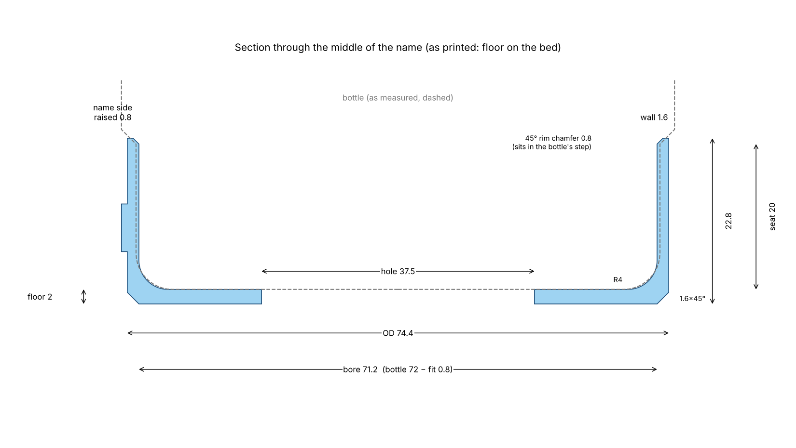
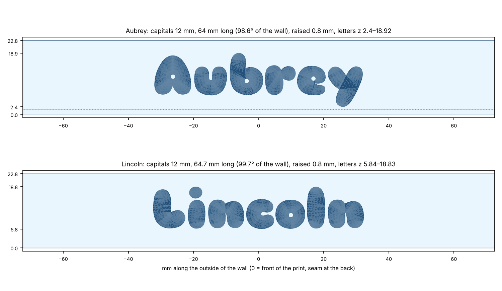

# Smiggle bottle bumper: TPU, with a name — v0.1

A TPU copy of the silicone boot on the bottom of a Smiggle drink bottle, with the owner's name raised on the side. Stretch fit over the bottle's stepped-down base, open centre like the original, prints in one go with no supports. Made for **Aubrey** and **Lincoln**; any other name is one command (`bumper.py`). Status: **v0.1, STLs and G-code ready, not printed.** 22 Nov 2026.


## Request (verbatim)

22 Nov 2026, 13:21:

> I got these smuggle water bottles the other day and they have a silicon bumper on the bottom. I want to recreate them in TPU, and emboss the names Aubrey and Lincoln  into each bumper

Attached: three photos, kept in `img/photos/`:

- `IMG_2161`: the bottle's base with the bumper off, marked up: body **76**, base section **72**, a **45°** step between them, and **15** along the base section.
- `IMG_2162`: the same view with the light-blue bumper on. It sits flush with the body.
- `IMG_2163`: the bumper end-on, on the bottle: **75** across, **37.5** centre hole.

Printer: Prusa i3 MK3S+. Project preference: functional over pretty, faster over perfect; TPU first.

## Next step

1. **Check one number: the seat depth.** Measure from where the 45° step starts down to the very bottom of the bottle (calipers, depth rod against the base). The model uses **20 mm**, not the 15 on the photo; see *Measurements* below for why. If you get something else, regenerate with `--set seat_depth=<mm>` (1 s) and re-slice (30 s).
2. **Optional, 22 min: fit gauge.** Print `gcode/fit_gauge_TPU_0.20SPEED.gcode` (4.5 g). Three 3 mm rings at different bores; the number of lugs on the outside says which:

   | Lugs | Bore | `fit` |
   |---|---|---|
   | 1 | 70.6 | 1.4 (tightest) |
   | 2 | 71.2 | **0.8 (what the bumpers use)** |
   | 3 | 71.8 | 0.2 |

   Push each one onto the bottle's base. Pick the loosest ring that still needs a firm push and doesn't slide down when you tip the bottle over. The real bumper is seven times taller, so it grips about seven times harder than the ring. If that isn't the 2-lug ring, regenerate with `--set fit=<value>`.
3. **Print the bumpers:** `gcode/aubrey_bumper_TPU_0.20SPEED.gcode` and `gcode/lincoln_bumper_TPU_0.20SPEED.gcode`, **86 min and 18.7 g each** (eSun TPU 95A FAST preset). The `_TPUsafe_` versions are the conservative preset: 108 min.
   - Usual TPU prep: dry filament, idler loosened, glue stick on smooth PEI.
   - The name faces the front of the bed; the seam is at the back.
4. **Check and report back:**

| Check | Pass | If not → change |
|---|---|---|
| Goes on | rolls over the bottle's rounded base with a firm push, no tools | won't go → `fit` smaller (0.4); spins or falls off → `fit` larger (1.2–1.4) |
| Depth | rim sits up against the 45° step and the bottle stands on the floor of the bumper | gap above the rim → `seat_depth` up; bottle sits proud of the floor → `seat_depth` down |
| Stands flat | no rock on a table | bottom lip from elephant foot → raise *Elephant foot compensation* to 0.3 |
| Name | letters crisp, readable | blobby → TPU safe G-code; too subtle → `--emboss 1.0` or `--letter-h 13` |

## Measurements and what was assumed

| | From you | Used | Note |
|---|---|---|---|
| Bottle body | 76 | 76 | only for the drawing; the bumper stays under it |
| Base section | 72 | 72 → bore **71.2** | 0.8 smaller so the TPU stretches on (`fit`) |
| Step | 45° | 45°, 2 mm deep | the rim's inside chamfer (0.8) sits in it |
| Base section length | 15 | **seat depth 20** | see below |
| Bottle's bottom edge | – | R5 | from photo 1; bumper inside fillet is R4 so the base reaches the floor |
| Bumper outside | 75 | **74.4** printed, ~75.2 stretched on | wall 1.6 |
| Centre hole | 37.5 | 37.5 | |

**Why 20, not 15.** Scaled off photo 1 (the 76 mm body is about 1180 px across), the start of the step to the end of the bottle is about 310 px, or 20 mm. Of that, about 15 mm is straight and the last ~5 mm is the bottom edge rounding over, so the 15 looks like the straight part. Photo 2 agrees: the bumper is about 24.5 mm long against the same 76 mm, which fits 20 mm of bottle plus a floor, where 15 + floor would be ~17. If step-to-base really is 15, this bumper still goes on, but the rim stops at the step with the base 5 mm off the floor. Regenerate with `seat_depth=15` before printing in that case.



## Design

- **Shape** (as printed, floor on the bed): a cup 74.4 across and 22.8 tall. Wall 1.6, floor 2.0, Ø37.5 hole in the floor like the original.
- **Fit.** Bore 71.2 on a 72 bottle: about 1 % hoop stretch. Silicone gets away with far more; TPU 95A is much stiffer, which is why `fit` is small and the gauge exists.
- **Rim.** A 0.8 × 45° chamfer inside the rim follows the bottle's 45° step, so the bumper seats against the step instead of stopping on its corner. It also gives a lead-in when pushing it on.
- **Inside corner.** R4 fillet from floor to wall, under the bottle's ~R5 edge, so the bottle sits on the floor, not on the fillet. Printed floor-down, the fillet only ever widens going up: no overhang.
- **Outside bottom edge.** 1.6 × 45° chamfer. It prints fine at 45° and stops TPU elephant foot from leaving a lip that would make the bottle rock.
- **Name.** Sniglet ExtraBold (bundled, SIL OFL), 12 mm capitals, raised 0.8 mm, wrapped round the wall (not projected), so the letters keep their shape and depth across the whole word. The cap height is centred on the outside wall; descenders (the y in Aubrey) push the baseline up if they'd reach the bottom chamfer. Aubrey and Lincoln both cover about 100° of the wall. Raised rather than cut in: cutting 0.8 into a 1.6 wall would halve it under every letter, right where it stretches.
- **Print orientation:** floor on the bed, opening up. No supports. The only overhangs are the 0.8 mm undersides of the letters and the 45° bottom chamfer.
- **Seam** at the back (`seam_position = rear`), with the name facing the front, so the seam stays out of the letters. The tiny counters in A, b, e, o get their own seams; at 0.8 deep they may fill in, which doesn't matter.



## Make one for another name

```
python3 bumper.py --name Mia                          # 12 mm capitals, raised 0.8, in ./out
python3 bumper.py --name Mia --png                    # + a 3D preview PNG
python3 bumper.py --name Mia --emboss -0.6            # cut into the wall instead of raised
python3 bumper.py --name Mia --set copies=2 --set text_angle=90   # on both sides, seam between
python3 bumper.py --name Mia --set fit=1.2 --set seat_depth=21
python3 bumper.py --name Mia --font "DejaVu Sans:style=Bold"
python3 bumper.py --list-fonts
```

Writes `<name>_bumper.stl` (print orientation) and `<name>_info.json` to `./out` in about a second. A long name is shrunk to fit `--max-deg` (120° of the wall by default); the script warns and says so. `--max-deg 300` wraps further round.

How it works: `bumper.scad` holds the model. The script asks OpenSCAD for three 2D things: the half section, the name laid flat, and a probe to measure the cap height. It then revolves the section and wraps the name round the wall with manifold3d. The same `.scad` also renders the whole bumper on its own in OpenSCAD (`openscad -D 'name="Mia"' bumper.scad`), by cutting the name into 0.5 mm strips and turning each to its angle. That takes about 80 s in 2021.01 and gives the same part: 14.856 vs 14.859 cm³ for Aubrey, same bounding box.

## Parameters (`bumper.scad`, or `--set key=value`)

| Group | Parameter | Default | Notes |
|---|---|---|---|
| Name | `name`, `font` | Aubrey, Sniglet ExtraBold | `--name`, `--font` |
| | `emboss` | 0.8 | + raised, − cut in. `--emboss` |
| | `emboss_root` | 0.3 | how far raised letters sink into the wall |
| | `copies`, `text_angle` | 1, 0 | 0° = front (−Y) |
| | `text_size`, `baseline_z`, `text_dx` | set by `bumper.py` | from `--letter-h` (12) and `--max-deg` (120) |
| Bottle | `bottle_d` | 72 | the base section |
| | `seat_depth` | **20** | start of the step to the bottom of the bottle |
| | `base_r` | 5 | bottle's bottom edge (drawing only) |
| Bumper | `fit` | 0.8 | bore = `bottle_d − fit` |
| | `wall`, `floor_t`, `hole_d` | 1.6, 2.0, 37.5 | |
| | `top_c`, `bot_c`, `inner_r` | 0.8, 1.6, 4 | rim chamfer, bottom chamfer, inside fillet |
| Gauge | `gauge_fits`, `gauge_h` | [1.4, 0.8, 0.2], 3 | ring n has n lugs |

## Print settings and times

PrusaSlicer 2.7.2 CLI: stock *Original Prusa i3 MK3S & MK3S+*, *0.20mm SPEED @MK3* (2 perimeters, Arachne, 15 % infill, which leaves the 2 mm floor nearly all solid), plus *Avoid crossing perimeters* and *Seam position: Rear*. TPU presets from `printer-profiles/esun-tpu95a-mk3s`.

| Part | TPU FAST | TPU safe |
|---|---|---|
| Aubrey bumper | **86 min, 18.7 g** | 108 min, 18.2 g |
| Lincoln bumper | **86 min, 18.7 g** | 108 min, 18.2 g |
| Fit gauge (3 rings) | **22 min, 4.5 g** | 27 min, 4.4 g |

All six G-codes are in `gcode/`. TPU is held back by flow (mm³/s), not speed settings, and the 2 mm floor is about 45 % of the plastic, so a thinner floor is the main way to save time if it's ever needed.

## Open questions / to verify

- **Seat depth** (20 assumed, 15 marked on the photo). See *Next step* 1.
- **Fit** of 0.8 in TPU 95A: the gauge settles it.
- **Bottle's bottom edge radius** (~5) is from the photo. If it's much smaller, the bottle rides on the R4 fillet; set `inner_r` to 1 mm under the real radius.
- **Name size** (12 mm capitals, 0.8 raised) is a guess at "readable across a classroom".

## Files

| File | Purpose |
|---|---|
| `bumper.scad` | the model: `part = bumper | gauge | profile2d | text2d | probe | info` |
| `bumper.py` | name in, STL out (manifold3d, ~1 s) |
| `fonts/` | Sniglet ExtraBold + licence |
| `render_all.sh` | builds both bumpers, the gauge, previews and `info.json`, then runs `drawings.py` |
| `drawings.py` | `img/section.png`, `img/names_unwrapped.png` |
| `slice_all.py` | slices `stl/*.stl` in TPU FAST and TPU safe → `print_times.json`, G-code in `gcode/` |
| `stl/aubrey_bumper.stl`, `stl/lincoln_bumper.stl`, `stl/fit_gauge.stl` | print files, print orientation |
| `gcode/*` | ready to print |
| `img/photos/` | the three photos from the request |

Regenerate: `./render_all.sh && python3 slice_all.py`. Needs OpenSCAD 2021+, PrusaSlicer 2.7 CLI and xvfb-run; Python numpy, manifold3d, fontTools, trimesh, shapely and matplotlib.

## Changelog

- **v0.1** (22 Nov 2026): first design. Stretch-fit cup with a 45° rim chamfer, raised name wrapped round the wall, Aubrey and Lincoln, three-ring fit gauge, generator for any name.

## Ideas for v0.2

- Thinner or ribbed floor to cut print time.
- A shallow debossed name filled with paint pen would read better than raised single-colour TPU. A layer colour change (M600) can't pick out letters on a vertical wall.
