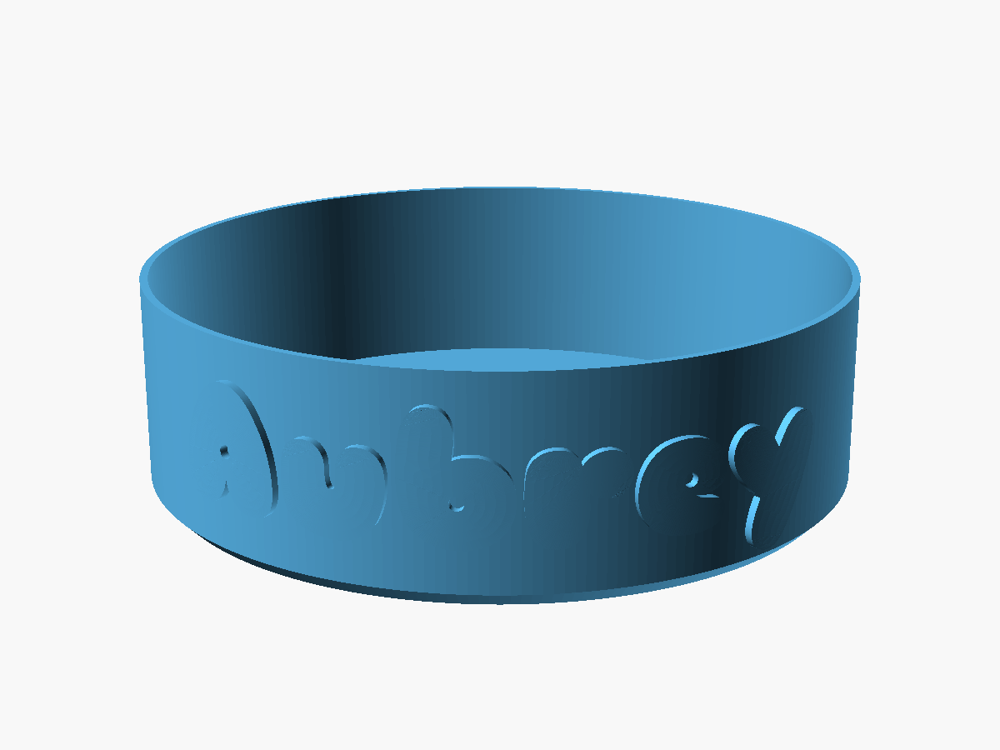

# Smiggle bottle bumper: TPU, with a name — v0.2

A TPU copy of the silicone boot on the bottom of a Smiggle drink bottle, with the owner's name raised on the side. It's a stretch fit over the bottle's stepped-down base, with an open centre like the original. **It prints in spiral vase mode:** a solid floor, then the wall as one continuous line from bottom to top. That means no layer changes, no seam and no retractions in the wall. Made for **Aubrey** and **Lincoln**; any other name is one command (`bumper.py`). Status: **v0.2 (vase mode), STLs and G-code ready, not printed.** 22 Nov 2026.



## Requests (verbatim)

22 Nov 2026, 13:21:

> I got these smuggle water bottles the other day and they have a silicon bumper on the bottom. I want to recreate them in TPU, and emboss the names Aubrey and Lincoln  into each bumper

Attached: three photos, kept in `img/photos/`:

- `IMG_2161`: the bottle's base with the bumper off, marked up: body **76**, base section **72**, a **45°** step between them, and **15** along the base section.
- `IMG_2162`: the same view with the light-blue bumper on. It sits flush with the body.
- `IMG_2163`: the bumper end-on, on the bottle: **75** across, **37.5** centre hole.

22 Nov 2026, 13:42:

> Push everything to GitHub

22 Nov 2026, 14:35:

> Slicing needs to be optimised to take into account the fact that the bumper is lan almost perfectly cylindrical vase

22 Nov 2026, 14:36:

> It keeps jumping to a different xy point on layer change

Printer: Prusa i3 MK3S+. Project preference: functional over pretty, faster over perfect; TPU first.

## Next step

1. **Check one number: the seat depth.** Measure from where the 45° step starts down to the very bottom of the bottle (calipers, depth rod against the base). The model uses **20 mm**, not the 15 on the photo; see *Measurements* below for why. If you get something else, regenerate with `--set seat_depth=<mm>` (1 s) and re-slice (30 s).
2. **Optional, 6 min each: fit rings.** The v0.2 wall is half as thick as v0.1's, so the fit has changed. There are three 6 mm rings, one G-code each, because vase mode prints one object at a time. Start with `gcode/fit_ring_2_default_TPU_0.20SPEED_vase.gcode` (5.7 min, 1.5 g). The lugs on the outside tell them apart:

   | Ring | Lugs | Bore | `fit` |
   |---|---|---|---|
   | `fit_ring_1_tight` | 1 | 69.8 | 2.2 |
   | `fit_ring_2_default` | 2 | 70.4 | **1.6 (what the bumpers use)** |
   | `fit_ring_3_loose` | 3 | 71.0 | 1.0 |

   Push it onto the bottle's base. It should need a firm push and not slide down when you tip the bottle over. The bumper's wall is about three times taller, so it grips about three times harder. Too loose → print ring 1; too hard to get on → ring 3. Then regenerate with `--set fit=<value>` if it isn't ring 2.
3. **Print the bumpers:** `gcode/aubrey_bumper_TPU_0.20SPEED_vase.gcode` and `gcode/lincoln_bumper_TPU_0.20SPEED_vase.gcode`, **50 min and 12.3 g each** (eSun TPU 95A FAST preset). The `_TPUsafe_` versions use the conservative preset: 69 min.
   - Usual TPU prep: dry filament, idler loosened, glue stick on smooth PEI.
   - The first 10 layers are the floor, printed normally, so they still travel and retract at each layer change. From 2 mm up it's one spiral that doesn't stop.
   - The name faces the front of the bed.
4. **Check and report back:**

| Check | Pass | If not → change |
|---|---|---|
| Goes on | rolls over the bottle's rounded base with a firm push, no tools | won't go → `fit` smaller (1.0); spins or falls off → `fit` larger (2.2) |
| Depth | rim sits up against the 45° step and the bottle stands on the floor of the bumper | gap above the rim → `seat_depth` up; bottle sits proud of the floor → `seat_depth` down |
| Wall | holds its shape on the bottle, doesn't tear going on | flimsy → a wider line: `wall = 1.0` in `bumper.scad`, then `./render_all.sh && python3 slice_all.py` (the slicer takes the line width from `info.json`) |
| Stands flat | no rock on a table | bottom lip from elephant foot → raise *Elephant foot compensation* to 0.3 |
| Name | letters crisp, readable | blobby → TPU safe G-code; too subtle → `--emboss 1.0` or `--letter-h 13` |

## Measurements and what was assumed

| | From you | Used | Note |
|---|---|---|---|
| Bottle body | 76 | 76 | only for the drawing; the bumper stays under it |
| Base section | 72 | 72 → bore **70.4** | 1.6 smaller so the TPU stretches on (`fit`) |
| Step | 45° | 45°, 2 mm deep | the rim stops at the start of the step |
| Base section length | 15 | **seat depth 20** | see below |
| Bottle's bottom edge | – | R5 | from photo 1; the bumper's inside corner is square, so the base sits on the floor |
| Bumper outside | 75 | **72.0** printed, ~73.6 stretched on | wall 0.8, one line; letters stand out to ~75 |
| Centre hole | 37.5 | 37.5 | |

**Why 20, not 15.** Scaled off photo 1 (the 76 mm body is about 1180 px across), the start of the step to the end of the bottle is about 310 px, or 20 mm. Of that, about 15 mm is straight and the last ~5 mm is the bottom edge rounding over, so the 15 looks like the straight part. Photo 2 agrees: the bumper is about 24.5 mm long against the same 76 mm, which fits 20 mm of bottle plus a floor, where 15 + floor would be ~17. If step-to-base really is 15, this bumper still goes on, but the rim stops at the step with the base 5 mm off the floor. Regenerate with `seat_depth=15` before printing in that case.


## Design

- **Shape** (as printed, floor on the bed): a cup 72.0 across and 22 tall. Wall 0.8, floor 2.0, Ø37.5 hole in the floor like the original.
- **Built for vase mode.** PrusaSlicer's spiral vase prints the floor as normal solid layers. It then prints the wall as one line that follows the **outside** of the model and climbs continuously, ignoring the inside. So the wall here is exactly one 0.8 line wide, and the bore is OD − 1.6. v0.1's inside rim chamfer and floor fillet are gone, because vase mode can't print inside detail.
- **Fit.** Bore 70.4 on a 72 bottle is about 2.3 % hoop stretch. With half the wall of v0.1, that's twice the stretch for about the same grip. TPU 95A takes that easily.
- **Rim.** Square. It stops at the start of the bottle's 45° step.
- **Inside corner.** Square, under the bottle's ~R5 edge, so the bottle sits on the floor.
- **Outside bottom edge.** 1.6 × 45° chamfer. It prints fine at 45° and stops TPU elephant foot from leaving a lip that would make the bottle rock.
- **Name.** Sniglet ExtraBold (bundled, SIL OFL), 12 mm capitals, raised 0.8 mm, wrapped round the wall (not projected), so the letters keep their shape and depth across the whole word. The cap height is centred on the outside wall; descenders (the y in Aubrey) push the baseline up if they'd reach the bottom chamfer. Aubrey and Lincoln both cover about 100° of the wall.
  - In vase mode, the wall line steps out 0.8 round each letter. So the letters are raised outside and leave matching shallow pockets inside, where they don't touch the bottle.
  - The tiny counters (holes) in A, b, e and o fill in.
  - Raised, not cut in: cut-in letters would push bumps into the bore, against the bottle.
- **Print orientation:** floor on the bed, opening up. No supports. The only overhangs are the 0.8 mm steps under the letters and the 45° bottom chamfer.
- **Trade-off vs v0.1:** the bumper sits about 1.2 mm under the bottle body all round (v0.1 was flush), because one line can't make a 2 mm wall. The raised letters come out about flush with the body.


## Make one for another name

```
python3 bumper.py --name Mia                          # 12 mm capitals, raised 0.8, in ./out
python3 bumper.py --name Mia --png                    # + a 3D preview PNG
python3 bumper.py --name Mia --set copies=2 --set text_angle=90   # on both sides
python3 bumper.py --name Mia --set fit=2.2 --set seat_depth=21
python3 bumper.py --name Mia --font "DejaVu Sans:style=Bold"
python3 bumper.py --list-fonts
```

Writes `<name>_bumper.stl` (print orientation) and `<name>_info.json` to `./out` in about a second. A long name is shrunk to fit `--max-deg` (120° of the wall by default); the script warns and says so. `--max-deg 300` wraps further round. (`--emboss -0.6` cuts the name in instead, but in vase mode that pushes bumps into the bore, so don't use it with this slicing.)

To slice it: drop the STL in `stl/` and run `python3 slice_all.py mia_bumper`. Or do it by hand in PrusaSlicer, starting from *0.20mm SPEED @MK3* + *eSun TPU 95A FAST @MK3S*, and change these:

- *Print Settings → Layers and perimeters:* tick **Spiral vase**, **Bottom solid layers 10**, **Minimum shell thickness, bottom 0**. Ticking Spiral vase sets perimeters 1, top layers 0 and infill 0 %; say yes when it asks.
- *Print Settings → Advanced → Extrusion width:* **Perimeters 0.8** and **External perimeters 0.8**.

How it works: `bumper.scad` holds the model. The script asks OpenSCAD for three 2D things: the half section, the name laid flat, and a probe to measure the cap height. It then revolves the section and wraps the name round the wall with manifold3d. The same `.scad` also renders the whole bumper on its own in OpenSCAD (`openscad -D 'name="Mia"' bumper.scad`), by cutting the name into 0.5 mm strips and turning each to its angle. That takes about 80 s in 2021.01 and gives the same part (checked on v0.1: 14.856 vs 14.859 cm³, same bounding box).

## Parameters (`bumper.scad`, or `--set key=value`)

| Group | Parameter | Default | Notes |
|---|---|---|---|
| Name | `name`, `font` | Aubrey, Sniglet ExtraBold | `--name`, `--font` |
| | `emboss` | 0.8 | + raised, − cut in (not with vase mode) |
| | `emboss_root` | 0.3 | how far raised letters sink into the wall |
| | `copies`, `text_angle` | 1, 0 | 0° = front (−Y) |
| | `text_size`, `baseline_z`, `text_dx` | set by `bumper.py` | from `--letter-h` (12) and `--max-deg` (120) |
| Bottle | `bottle_d` | 72 | the base section |
| | `seat_depth` | **20** | start of the step to the bottom of the bottle |
| | `base_r` | 5 | bottle's bottom edge (drawing only) |
| Bumper | `fit` | **1.6** | bore = `bottle_d − fit` |
| | `wall` | **0.8** | = vase-mode line width; `slice_all.py` reads it from `info.json` |
| | `floor_t`, `hole_d` | 2.0, 37.5 | floor = `floor_t / 0.2` solid layers |
| | `top_c`, `inner_r` | 0, 0 | inside rim chamfer and floor fillet; only for non-vase slicing |
| | `bot_c` | 1.6 | outside bottom chamfer |
| Fit rings | `gauge_fits`, `gauge_h`, `ring` | [2.2, 1.6, 1.0], 6, 2 | `part="ring"` makes ring n (n lugs) |

## Print settings and times

PrusaSlicer 2.7.2 CLI: stock *Original Prusa i3 MK3S & MK3S+*, *0.20mm SPEED @MK3*, plus:

- **spiral vase**
- **perimeters 1**, at **0.8 wide** (internal and external)
- **10 bottom solid layers** (the 2 mm floor), bottom minimum thickness 0
- top layers 0, infill 0 %
- *Avoid crossing perimeters* and *Seam position: Rear*, which apply only to the floor layers

TPU presets come from `printer-profiles/esun-tpu95a-mk3s`. The rings have no floor (0 bottom layers), so after the 3 skirt layers they're all spiral.

| Part | TPU FAST | TPU safe |
|---|---|---|
| Aubrey bumper | **50 min, 12.3 g** | 69 min, 12.0 g |
| Lincoln bumper | **50 min, 12.3 g** | 69 min, 12.0 g |
| Fit ring (each) | **5.7 min, 1.5 g** | 8.1 min, 1.4 g |

**v0.1 → v0.2, Aubrey, TPU FAST:**

| | v0.1 (2 perimeters, normal layers) | v0.2 (vase) |
|---|---|---|
| Time | 86 min | 50 min |
| Retractions | 621 (509 in the wall) | 58: 57 in the 10 floor layers, 1 at the end, 0 in the wall |
| Layer changes with a travel | every layer | floor only |

Checked in the G-code: the wall path runs at r 35.6 (so the bore is 70.4 and the OD is 72.0). Over the letters it steps out to r 36.4. The floor keeps its Ø37.5 hole, and the spiral starts at z 2.0 and runs to the top with no retraction. Every G-code is in `gcode/`.

Tried and dropped: concentric top/bottom fill on the floor. It's a round annulus, so it looked like a fit, but in a test it gave 131 retractions against 61, because each ring retracts.

## Open questions / to verify

- **Seat depth** (20 assumed, 15 marked on the photo). See *Next step* 1.
- **Fit** of 1.6 on a 0.8 vase wall in TPU 95A: the rings settle it.
- **Wall stiffness**: is one 0.8 line enough? It's stiffer than the original's 1.5 mm silicone, but floppy off the bottle. `wall = 1.0` is the next step: 2.5× the 0.4 nozzle, which is about as wide as it's sensible to push a single line.
- **Bottle's bottom edge radius** (~5) is from the photo.
- **Name size** (12 mm capitals, 0.8 raised) is a guess at "readable across a classroom".

## Files

| File | Purpose |
|---|---|
| `bumper.scad` | the model: `part = bumper | ring | gauge | profile2d | text2d | probe | info` |
| `bumper.py` | name in, STL out (manifold3d, ~1 s) |
| `fonts/` | Sniglet ExtraBold + licence |
| `render_all.sh` | builds both bumpers, the three fit rings, previews and `info.json`, then runs `drawings.py` |
| `drawings.py` | `img/section.png`, `img/names_unwrapped.png` |
| `slice_all.py` | slices `stl/*.stl` in vase mode, TPU FAST and TPU safe → `print_times.json`, G-code in `gcode/`. `python3 slice_all.py aubrey_bumper` does one part |
| `stl/aubrey_bumper.stl`, `stl/lincoln_bumper.stl` | the bumpers, print orientation |
| `stl/fit_ring_{1_tight,2_default,3_loose}.stl` | fit rings |
| `gcode/*_vase.gcode` | ready to print |
| `img/photos/` | the three photos from the request |

Regenerate: `./render_all.sh && python3 slice_all.py`. Needs OpenSCAD 2021+, PrusaSlicer 2.7 CLI and xvfb-run; Python numpy, manifold3d, fontTools, trimesh, shapely and matplotlib.

## Changelog

- **v0.2** (22 Nov 2026): spiral vase mode.
  - Model: wall 1.6 → one 0.8 line; `fit` 0.8 → 1.6; inside rim chamfer and floor fillet removed; height 22.8 → 22.
  - Slicing: vase mode, 0.8 lines, 10 bottom layers; G-code names end `_vase`. Bumper 86 → 50 min (TPU FAST), 621 → 58 retractions.
  - The three-ring gauge became three separate fit rings (vase mode prints one object at a time), now 6 mm tall.
- **v0.1** (22 Nov 2026): first design. Stretch-fit cup with a 45° rim chamfer, raised name wrapped round the wall, Aubrey and Lincoln, three-ring fit gauge, generator for any name. Normal slicing: 2 perimeters, 86 min.

## Ideas for v0.3

- A thinner floor: it's now over half the plastic and all of the remaining retractions.
- A shallow cut-in name filled with paint pen would read better than raised single-colour TPU, but it needs non-vase slicing (see `emboss`).
